# CAPÍTULO 6

# DISEÑO DEL SISTEMA

Este capítulo describe el diseño conceptual del sistema antes de iniciar su implementación. El diseño define cómo se estructurará la solución tecnológica para cumplir los requerimientos identificados. Vitalsy se concebirá como dos productos que comparten el mismo dominio clínico: Vitalsy Clinical, la aplicación web del hospital, y Vitalsy Life, la aplicación móvil de la persona.

## 6.1. Arquitectura Conceptual del Sistema

Vitalsy Clinical se estructurará en tres planos. El plano de presentación será una aplicación de página única. El plano de aplicación será una API HTTP. El plano de persistencia será una base relacional. Un servidor de entrada recibirá el tráfico del navegador y lo repartirá: las pantallas irán al plano de presentación y las llamadas de datos, junto con la cookie de sesión, irán a la API.

El personal del hospital no accederá a la base. Abrirá el navegador, iniciará sesión y trabajará en pantallas acotadas por su rol. Cada pantalla llamará a la API bajo el prefijo `/api/v1`. La API autenticará la sesión, comprobará el rol y delegará la regla de negocio en un servicio de dominio. Ese servicio leerá o escribirá el modelo del encuentro. La base guardará pacientes, ingresos, órdenes, alertas, egresos, camas y turnos.

Vitalsy Life se diseñará como aplicación del teléfono, con almacenamiento local y una cola de sincronización para los momentos sin red. El contrato previsto con el hospital será `POST /api/life/sync`, para enviar el lote de mediciones, consentimientos o plan, y `GET /api/life/discharge-plans/{code}`, para recuperar el plan de seguimiento al alta.

Los componentes funcionales de la web serán: admisión, censo de admisión, kardex de ingreso, traslado, valoración de enfermería, conciliación de medicación, escalas de riesgo, indicaciones médicas, laboratorio, imágenes, visita clínica, evolución médica, prescripción electrónica (CPOE), monitoreo de constantes, e-MAR, controles programados, cuidados de enfermería, expediente clínico, alertas, egreso, gestión de camas y rol de personal. La API agrupará esa misma responsabilidad en los prefijos `hospital-admission`, `inpatient-care`, `clinical-alerts`, `discharge`, `beds` y `staff`.

La interoperabilidad con laboratorio e imagen se resolverá mediante clientes de aplicación (`LisClient` y `PacsClient`). En el diseño inicial, esas fuentes se sustituirán por implementaciones de prueba (`StubLisClient` y `StubPacsClient`) hasta contar con el servicio externo.

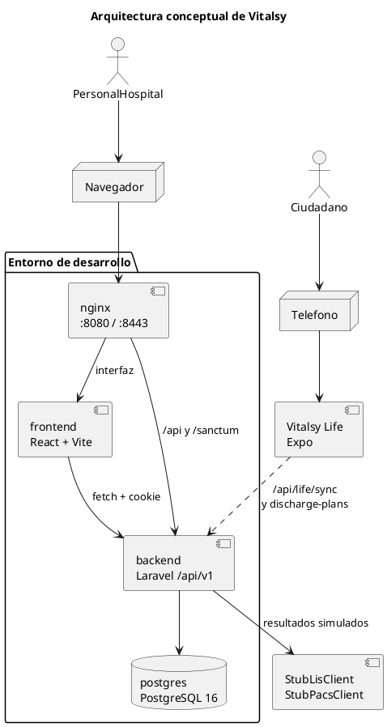

**Figura 6.1.** Arquitectura conceptual prevista. El navegador tendrá un único punto de entrada. La web y la API se hablarán por HTTP en el mismo origen. La base relacional guardará el encuentro hospitalario. Vitalsy Life vivirá en el teléfono y se vinculará al hospital por el contrato `/api/life`.

## 6.2. Modelo UML del Sistema

### Actores

El diseño fija un catálogo de catorce actores hospitalarios. Cada clave será el rol con el que la persona entra y el límite de lo que podrá hacer:

| Clave | Actor en la interfaz |
|---|---|
| `admision` | Admisión |
| `camillero` | Celador / Camillero |
| `enfermera_piso` | Enfermera de piso |
| `auxiliar_enfermeria` | Auxiliar de enfermería |
| `medico_residente` | Médico residente |
| `medico_tratante` | Médico tratante |
| `enfermera_supervisora` | Enfermera supervisora de piso |
| `equipo_respuesta_rapida` | Equipo de Respuesta Rápida |
| `trabajo_social` | Trabajo social |
| `altas_caja` | Altas / Caja |
| `gestion_camas` | Gestión de camas |
| `servicios_generales` | Servicios generales / Limpieza |
| `jefatura_enfermeria` | Jefatura de enfermería |
| `recursos_humanos` | Recursos humanos |

El ciudadano de Vitalsy Life quedará fuera de ese catálogo. Entrará por la aplicación móvil, con una sesión propia del teléfono. El diseño añade, para la gestión de cuentas (RF-101 a RF-104), un actor de administración de accesos que podrá consultar, registrar, actualizar y desactivar usuarios del personal.

### Diagrama de casos de uso

Cada diagrama junta un solo actor con sus casos, o varios actores con un único caso. Así cada flecha tiene un destino visible. El detalle de cada pantalla está en el apartado 6.3.

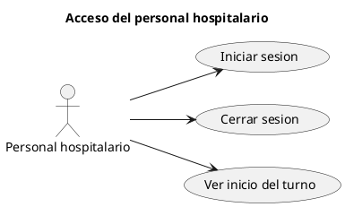

**Figura 6.2a.** Acceso. El mismo caso vale para los catorce roles del hospital: sin sesión solo se ve el inicio; con sesión, el tablero del rol.

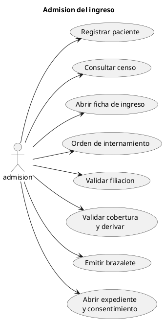

**Figura 6.2b.** Admisión. Un solo actor recorre el ingreso hasta el consentimiento.

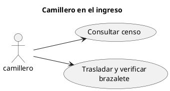

**Figura 6.2c.** Camillero. Consulta el censo y verifica el brazalete en el traslado.

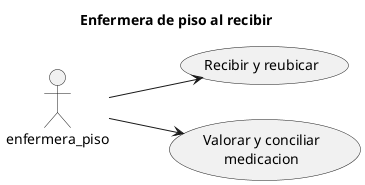

**Figura 6.2d.** Recepción en piso. La enfermera recibe al paciente y concilia la medicación.

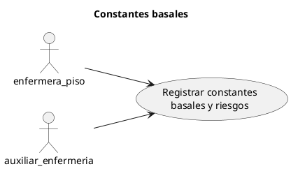

**Figura 6.2e.** Constantes basales. Las dos flechas llegan al mismo caso: la enfermera de piso y el auxiliar pueden registrar la toma y los riesgos.

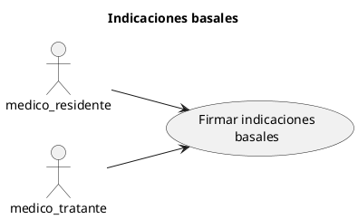

**Figura 6.2f.** Indicaciones basales. Residente y tratante firman el mismo caso.

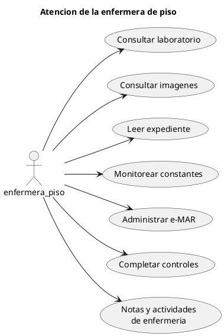

**Figura 6.2g.** Atención de la enfermera de piso. El e-MAR queda solo en este rol.

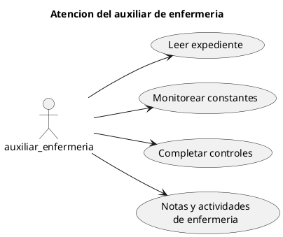

**Figura 6.2h.** Atención del auxiliar. Lee el expediente, toma constantes, completa controles y registra cuidados. No prescribe ni administra el e-MAR.

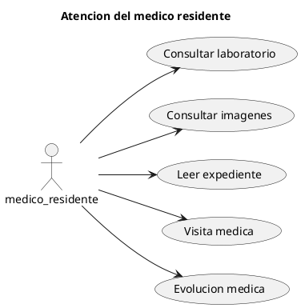

**Figura 6.2i.** Atención del médico residente. Consulta paraclínicos y expediente, visita y evoluciona.

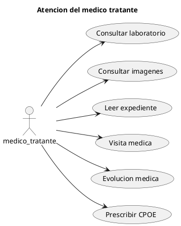

**Figura 6.2j.** Atención del médico tratante. Suma la prescripción CPOE a la visita y la evolución.

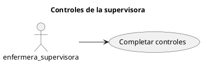

**Figura 6.2k.** Controles. La supervisora completa el mismo caso de control que la enfermera de piso y el auxiliar, cada una en su diagrama.

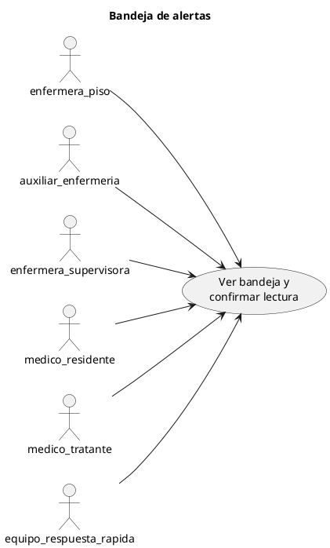

**Figura 6.2l.** Bandeja. Las seis flechas llegan a un solo caso: ver la alerta y confirmar la lectura.

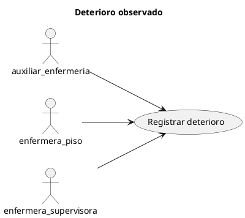

**Figura 6.2m.** Deterioro observado. Auxiliar, enfermera de piso y supervisora abren el mismo caso.

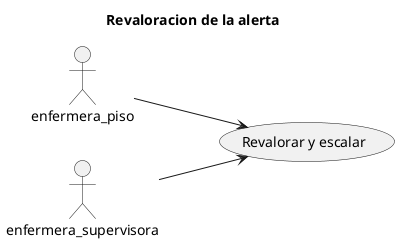

**Figura 6.2n.** Revaloración. Enfermera de piso y supervisora toman de nuevo las constantes y escalan.

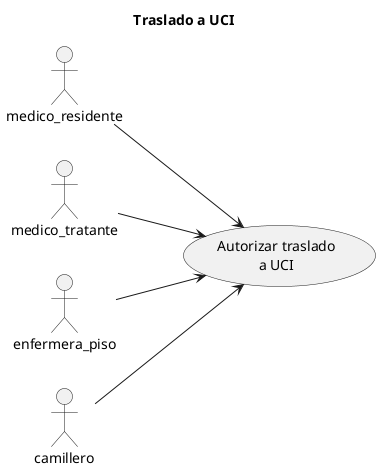

**Figura 6.2o.** Traslado a UCI. Medicina autoriza, la enfermera de piso confirma y el camillero traslada. Las cuatro flechas llegan a ese único caso.

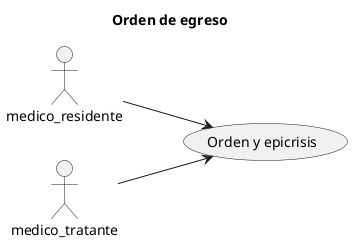

**Figura 6.2p.** Orden de egreso. Residente y tratante registran la orden y la epicrisis.

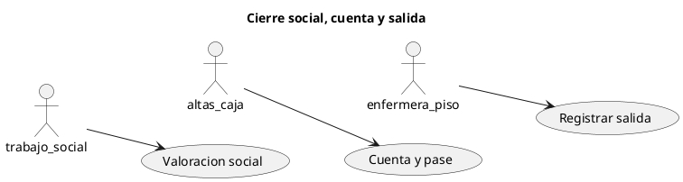

**Figura 6.2q.** Cierre del egreso. Cada actor tiene un solo caso: trabajo social valora, caja emite la cuenta y el pase, y la enfermera de piso registra la salida.

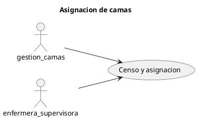

**Figura 6.2r.** Asignación de camas. Gestión de camas y la supervisora consultan el censo y asignan el lecho.

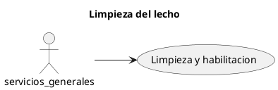

**Figura 6.2s.** Limpieza. Servicios generales ejecuta el protocolo y habilita la cama.

```plantuml
@startuml
left to right direction
title Rol de turnos

actor "jefatura_enfermeria" as Jef
actor "enfermera_supervisora" as Sup

usecase "Rol de turnos y\nasignacion" as UCTurno

Jef --> UCTurno
Sup --> UCTurno
@enduml
```

**Figura 6.2t.** Rol de turnos. Jefatura publica el rol y la supervisora asigna pacientes del día.

```plantuml
@startuml
left to right direction
title Entrega de turno

actor "enfermera_piso" as Enf

usecase "Entrega de turno" as UCHand

Enf --> UCHand
@enduml
```

**Figura 6.2u.** Entrega de turno. La enfermera de piso firma el relevo.

```plantuml
@startuml
left to right direction
title Ausencia y reten

actor "enfermera_supervisora" as Sup
actor "recursos_humanos" as Rh

usecase "Ausencia, cobertura\ny reten" as UCRet

Sup --> UCRet
Rh --> UCRet
@enduml
```

**Figura 6.2v.** Retén. La supervisora registra la ausencia y la cobertura; recursos humanos autoriza.

```plantuml
@startuml
left to right direction
title Vitalsy Life en el telefono

actor "Ciudadano" as Ciu

usecase "Registrar o entrar" as UCAuth
usecase "Ver el dia y tendencias" as UCHoy
usecase "Recibir aviso\npreventivo" as UCAvis
usecase "Sincronizar dispositivo" as UCDev
usecase "Administrar privacidad" as UCPriv
usecase "Mostrar codigo\nde vinculacion" as UCQr
usecase "Enviar lote de\nlinea de base" as UCSync
usecase "Activar plan\npost alta" as UCPlan

Ciu --> UCAuth
Ciu --> UCHoy
Ciu --> UCAvis
Ciu --> UCDev
Ciu --> UCPriv
Ciu --> UCQr
Ciu --> UCSync
Ciu --> UCPlan
@enduml
```

**Figura 6.2w.** Vitalsy Life en el teléfono. El aviso preventivo y el lote nacen aquí, antes de cruzar al hospital.

```plantuml
@startuml
left to right direction
title Vinculacion del codigo con el ingreso

actor "admision" as Adm
actor "enfermera_piso" as Enf

usecase "Asociar el codigo\nen el ingreso" as UCVinc

Adm --> UCVinc
Enf --> UCVinc
@enduml
```

**Figura 6.2x.** Vinculación. Admisión o la enfermera de piso asocia el código o el QR que muestra la persona en la figura 6.2w.

```plantuml
@startuml
left to right direction
title Plan posterior al alta

actor "enfermera_piso" as Enf
actor "Ciudadano" as Ciu

usecase "Publicar indicaciones\ndel egreso" as UCAlta
usecase "Activar plan\npost alta" as UCPlan

Enf --> UCAlta
UCAlta ..> UCPlan : indicaciones
Ciu --> UCPlan
@enduml
```

**Figura 6.2y.** Plan posterior al alta. La enfermera publica las indicaciones y el ciudadano activa ese plan en el teléfono.

### Diagrama de clases

El modelo de dominio se organizará alrededor del ingreso `AdmissionEncounter`. El paciente, sus contactos y sus alergias formarán un agregado propio, ligado al ingreso por documento y no por clave foránea. Las lecturas, los paraclínicos, las notas, las prescripciones, las alertas, el egreso y la asignación de personal se asociarán al encuentro mediante `encounter_id`. Las claves foráneas se reservarán a los agregados cerrados: paciente, ítem de prescripción, seguimiento de la alerta, sala, cama y personal. Los diagramas siguientes listan los atributos de cada agregado. Vitalsy Life se modela aparte, en el teléfono.

```plantuml
@startuml
title Clases de usuario, paciente e ingreso

class User {
  id : bigint
  name : string
  email : string
  role : string
  password : string
  is_active : boolean
  deactivated_at : timestamp
  email_verified_at : timestamp
}

class Patient {
  id : bigint
  document_type : string
  document_number : string
  full_name : string
  birth_date : date
  sex : string
}

class PatientContact {
  id : bigint
  patient_id : bigint
  name : string
  phone : string
  relationship : string
}

class PatientAllergy {
  id : bigint
  patient_id : bigint
  substance : string
  notes : text
  is_optional : boolean
}

class AdmissionEncounter {
  id : bigint
  encounter_id : string
  order_number : string
  source : string
  transfer_order_number : string
  patient_name : string
  document_type : string
  document_number : string
  origin_service : string
  coverage_payer : string
  coverage_status : string
  coverage_plan : string
  room : string
  bed : string
  service : string
  wristband_code : string
  record_id : string
  current_step : string
  waiting_reason : string
  deliverables : json
  clinical_payload : json
}

class CoverageReferral {
  id : bigint
  encounter_id : string
  destination : string
  relative_name : string
  relative_phone : string
  "note" : text
  status : string
}

class InformedConsent {
  id : bigint
  encounter_id : string
  signer_name : string
  relationship : string
  accepted_at : timestamp
}

class NursingAssessment {
  id : bigint
  encounter_id : string
  chief_complaint : text
  history : text
  allergies : json
  recorded_by : string
}

class MedicationReconciliation {
  id : bigint
  encounter_id : string
  allergies : text
  medications : json
  status : string
}

class RiskAssessment {
  id : bigint
  encounter_id : string
  morse_score : smallint
  braden_score : smallint
  recommendations : text
}

class WristbandEvent {
  id : bigint
  encounter_id : string
  code : string
  action : string
}

Patient "1" *-- "0..*" PatientContact
Patient "1" *-- "0..*" PatientAllergy
AdmissionEncounter "0..*" .. "0..1" Patient : documento
AdmissionEncounter "1" .. "0..*" CoverageReferral : encounter_id
AdmissionEncounter "1" .. "0..*" InformedConsent : encounter_id
AdmissionEncounter "1" .. "0..*" NursingAssessment : encounter_id
AdmissionEncounter "1" .. "0..*" MedicationReconciliation : encounter_id
AdmissionEncounter "1" .. "0..*" RiskAssessment : encounter_id
AdmissionEncounter "1" .. "0..*" WristbandEvent : encounter_id
@enduml
```

**Figura 6.3a.** Usuario, paciente e ingreso. El avance del ingreso vive en `current_step`. `clinical_payload` y `deliverables` guardan el kardex de esta etapa. El par documento tipo y número es único en `patients` y es el vínculo con el encuentro.

```plantuml
@startuml
title Clases de constantes, paraclinicos y cuidado

class VitalSignReading {
  id : bigint
  encounter_id : string
  rr : smallint
  spo2 : smallint
  sbp : smallint
  dbp : smallint
  pulse : smallint
  temperature : decimal
  spo2_scale : string
  supplemental_oxygen : boolean
  consciousness : string
  news2_total : tinyint
  recorded_at : timestamp
}

class News2Calculator {
  calculate(signos) : total y parciales
}

class VitalSignsMonitoring {
  storeManual(encuentro, signos, usuario)
  storeTelemetry(encuentro, muestras, usuario)
  chart(encuentro)
}

class LabResult {
  id : bigint
  encounter_id : string
  external_id : string
  summary : text
  payload : json
  resulted_at : timestamp
}

class ImagingReport {
  id : bigint
  encounter_id : string
  external_id : string
  modality : string
  summary : text
  payload : json
  reported_at : timestamp
}

class MedicalEvolutionNote {
  id : bigint
  encounter_id : string
  author_user_id : bigint
  body : text
  signed_at : timestamp
}

class Prescription {
  id : bigint
  encounter_id : string
  status : string
  prescribed_by : bigint
  signed_at : timestamp
}

class PrescriptionItem {
  id : bigint
  prescription_id : bigint
  drug_name : string
  dose : string
  route : string
  frequency : string
}

class MedicationAdministration {
  id : bigint
  encounter_id : string
  prescription_item_id : bigint
  scheduled_at : timestamp
  administered_at : timestamp
  status : string
  nurse_user_id : bigint
  barcode_ok : boolean
}

class NursingEvolutionNote {
  id : bigint
  encounter_id : string
  author_user_id : bigint
  body : text
}

class CareActivityCompletion {
  id : bigint
  encounter_id : string
  activity_label : string
  completed_at : timestamp
  completed_by : bigint
}

VitalSignsMonitoring --> News2Calculator
VitalSignsMonitoring --> VitalSignReading : persiste la toma
Prescription "1" *-- "1..*" PrescriptionItem
PrescriptionItem "1" o-- "0..*" MedicationAdministration
MedicalEvolutionNote .. User : author_user_id
Prescription .. User : prescribed_by
MedicationAdministration .. User : nurse_user_id
@enduml
```

**Figura 6.3b.** Constantes, paraclínicos, prescripción y cuidados. `News2Calculator` produce `news2_total`. La prescripción agrupa ítems y cada ítem puede generar dosis del e-MAR. Laboratorio e imagen llegan con un identificador externo y un resumen.

```plantuml
@startuml
title Clases de alertas y escalamiento NEWS2

class ClinicalAlert {
  id : bigint
  encounter_id : string
  source : string
  compliance_key : string
  severity : string
  news2_total : tinyint
  message : text
  status : string
  assigned_role : string
  assigned_user_id : bigint
  created_by : bigint
  generated_at : timestamp
  acknowledge_due_at : timestamp
  follow_up_due_at : timestamp
  reassessed_at : timestamp
  medical_notified_at : timestamp
  medical_due_at : timestamp
  closed_at : timestamp
  closure_note : text
  icu_ordered_at : timestamp
  icu_doctor_authorized_at : timestamp
  icu_nurse_authorized_at : timestamp
  icu_transferred_at : timestamp
  icu_returned_at : timestamp
  icu_previous_room : string
  icu_previous_bed : string
  icu_previous_service : string
}

class AlertAcknowledgement {
  id : bigint
  alert_id : bigint
  user_id : bigint
  role : string
  acknowledged_at : timestamp
}

class AlertEscalation {
  id : bigint
  alert_id : bigint
  to_role : string
  reason : text
  escalated_at : timestamp
}

class AlertEvent {
  id : bigint
  alert_id : bigint
  type : string
  role : string
  user_id : bigint
  detail : text
  occurred_at : timestamp
}

class MonitoringSchedule {
  id : bigint
  encounter_id : string
  next_due_at : timestamp
  frequency_minutes : integer
  created_by : bigint
}

class AlertRecorder {
  openFromMonitoring(encuentro, news2, usuario)
  record(alerta, tipo, detalle, usuario)
}

class VitalSignsMonitoring {
  storeManual(encuentro, signos, usuario, activateAlerts)
}

class AlertWorkflow {
  acknowledge(alerta, usuario)
  reassess(alerta, signos, usuario)
  scheduleMonitoring(alerta, frecuencia, usuario)
  processOverdueAlerts()
}

class ComplianceAlertService {
  openDueTasks()
}

AlertRecorder --> ClinicalAlert : abre source news2
AlertWorkflow --> ClinicalAlert
AlertWorkflow --> VitalSignsMonitoring
AlertWorkflow --> MonitoringSchedule
ComplianceAlertService --> ClinicalAlert : source control o emar
ClinicalAlert "1" *-- "0..*" AlertAcknowledgement
ClinicalAlert "1" *-- "0..*" AlertEscalation
ClinicalAlert "1" *-- "0..*" AlertEvent
@enduml
```

**Figura 6.3c.** Alertas. `source` distingue `news2`, `control`, `emar` y `observacion`. La severidad alta corresponde a NEWS2 de 7 o más; la media, a un total entre 1 y 6. El acuse, el escalamiento y el evento cuelgan de `alert_id`.

```plantuml
@startuml
title Clases de egreso

class DischargeOrder {
  id : bigint
  encounter_id : string
  ordered_by : bigint
  ordered_at : timestamp
  status : string
}

class EpicrisisDocument {
  id : bigint
  encounter_id : string
  diagnoses : text
  procedures : text
  evolution : text
  authored_by : bigint
}

class AmbulatoryPrescription {
  id : bigint
  encounter_id : string
  content : json
  issued_at : timestamp
}

class SocialAssessment {
  id : bigint
  encounter_id : string
  report : text
  validated : boolean
  assessed_by : bigint
}

class PharmaDischargeReconciliation {
  id : bigint
  encounter_id : string
  notes : text
  status : string
}

class NursingDischargeReport {
  id : bigint
  encounter_id : string
  instructions : text
  alarm_signs : text
  home_care : text
}

class DischargeIndicationReceipt {
  id : bigint
  encounter_id : string
  received_by_name : string
  received_at : timestamp
}

class AccountVerification {
  id : bigint
  encounter_id : string
  status : string
  verified_at : timestamp
}

class ExitPass {
  id : bigint
  encounter_id : string
  issued_at : timestamp
  status : string
}

class PatientExit {
  id : bigint
  encounter_id : string
  exited_at : timestamp
  confirmed_by : bigint
}

DischargeOrder .. EpicrisisDocument : mismo encounter_id
EpicrisisDocument .. AmbulatoryPrescription
NursingDischargeReport .. DischargeIndicationReceipt
AccountVerification .. ExitPass
ExitPass .. PatientExit : la salida cierra la cadena
@enduml
```

**Figura 6.3d.** Cadena de egreso. Cada entregable comparte `encounter_id`. `PatientExit` registra la salida efectiva y es el hecho que libera la cama.

```plantuml
@startuml
title Clases de camas y personal

class Ward {
  id : bigint
  code : string
  name : string
  specialty : string
}

class Bed {
  id : bigint
  ward_id : bigint
  room : string
  bed_code : string
  gender_policy : string
  isolation : boolean
  status : string
}

class BedRequest {
  id : bigint
  encounter_id : string
  source : string
  priority : string
  status : string
  requested_at : timestamp
}

class BedAssignment {
  id : bigint
  bed_id : bigint
  encounter_id : string
  assigned_at : timestamp
  released_at : timestamp
}

class CleaningOrder {
  id : bigint
  bed_id : bigint
  protocol : string
  status : string
  dispatched_at : timestamp
  completed_at : timestamp
}

class BedReadinessCheck {
  id : bigint
  bed_id : bigint
  linen_ok : boolean
  supplies_ok : boolean
  confirmed_by : bigint
  confirmed_at : timestamp
}

class DischargeProjection {
  id : bigint
  encounter_id : string
  projected_at : timestamp
  noted_by : bigint
}

class StaffShiftPlan {
  id : bigint
  year_month : string
  published_at : timestamp
  published_by : bigint
}

class StaffShift {
  id : bigint
  plan_id : bigint
  user_id : bigint
  starts_at : timestamp
  ends_at : timestamp
  unit : string
}

class DailyPatientAssignment {
  id : bigint
  shift_date : date
  nurse_user_id : bigint
  encounter_id : string
  news2_weight : smallint
}

class Handover {
  id : bigint
  from_user_id : bigint
  to_user_id : bigint
  encounter_id : string
  payload : json
  signed_at : timestamp
}

class StaffAbsence {
  id : bigint
  user_id : bigint
  shift_date : date
  reason : string
  recorded_by : bigint
}

class CoverageRequest {
  id : bigint
  absence_id : bigint
  status : string
  approved_by : bigint
  authorized_by_hr : bigint
}

class RetainerConfirmation {
  id : bigint
  coverage_request_id : bigint
  user_id : bigint
  confirmed_at : timestamp
}

Ward "1" *-- "0..*" Bed
Bed "1" *-- "0..*" BedAssignment
Bed "1" *-- "0..*" CleaningOrder
Bed "1" *-- "0..*" BedReadinessCheck
StaffShiftPlan "1" *-- "0..*" StaffShift
StaffAbsence "1" o-- "0..*" CoverageRequest
CoverageRequest "1" *-- "0..*" RetainerConfirmation
DailyPatientAssignment .. User : nurse_user_id
Handover .. User : from_user_id y to_user_id
@enduml
```

**Figura 6.3e.** Camas y personal. El estado del lecho distingue disponible, ocupado, en limpieza y bloqueado. La asignación diaria guarda el peso NEWS2 para balancear la carga. La cobertura del retén nace de una ausencia.

```plantuml
@startuml
title Clases locales de Vitalsy Life

class MetricBaseline {
  kind : pasos, sueno u otra biometria
  status : building, within o sustained_deviation
  latest : number
  latestAt : string
  low : number
  high : number
  unit : string
  fittingDays : number
}

class NoticeDraft {
  id : string
  kind : habit, deviation o stability
  title : string
  body : string
  createdAt : string
  metric : kind de la linea de base
}

class Notices {
  draftNudge(lineas, ahora) : NoticeDraft o vacio
  caregiverText(aviso, nombre) : string
}

class SyncItem {
  id : string
  kind : biometrics, consent o plan
  body : string
  status : pending o synced
}

class HealthSync {
  enqueueSync(cola, item)
  decideFlush(cola, enLinea, apiConfigurada)
  markSynced(cola, ids)
}

class LifeClient {
  postLifeBatch(base, items)
  fetchDischargeBody(base, codigo)
}

Notices --> MetricBaseline
Notices --> NoticeDraft
HealthSync --> SyncItem
LifeClient --> SyncItem : POST /api/life/sync
LifeClient .. "plan de egreso" : GET /api/life/discharge-plans/{codigo}
@enduml
```

**Figura 6.3f.** Objetos de Vitalsy Life. Viven en el teléfono. El aviso preventivo sale de `draftNudge` cuando la línea de base lleva varios días fuera de rango. El lote `SyncItem` y el plan de alta cruzan hacia Clinical por el contrato `/api/life`.

### Diagrama de secuencia: inicio de sesión

El inicio de sesión web se diseñará con sesión de navegador. El personal no recibirá un token de acceso. El navegador pedirá la cookie de protección, enviará correo y contraseña, y el servidor renovará la sesión.

```plantuml
@startuml
title Secuencia de autenticacion web

actor Personal
participant "LoginPage" as Login
participant "api.ts" as Client
participant "Nginx" as Nginx
participant "AuthController" as Auth
database "sesion y users" as Db

Personal -> Login : correo y contrasena
Login -> Client : iniciar sesion
Client -> Nginx : GET /sanctum/csrf-cookie
Nginx -> Auth : cookie XSRF
Client -> Nginx : POST /api/v1/auth/login
Nginx -> Auth : login()
Auth -> Db : Auth::attempt
Auth -> Auth : session()->regenerate()
Auth --> Client : usuario, correo y rol
Client --> Login : SessionUser
Login --> Personal : Shell segun rol

@enduml
```

**Figura 6.4.** Secuencia prevista de autenticación. El acceso quedará limitado en intentos. Después del ingreso, la sesión permitirá recuperar al usuario. El cierre de sesión la invalidará.

### Diagrama de secuencia: filiación de un ingreso

La filiación se diseñará como un paso exclusivo del rol `admision`. La pantalla enviará el documento y los datos de identidad, y el servicio solo aceptará ese rol.

```plantuml
@startuml
title Secuencia de validar filiacion

actor "admision" as Adm
participant "FiliationPage" as Page
participant "api.ts" as Client
participant "HospitalAdmissionController" as Ctrl
participant "AdmissionEncounter" as Enc

Adm -> Page : documento y datos filiatorios
Page -> Client : POST /api/v1/hospital-admission/filiation/validate
Client -> Ctrl : validateFiliation()
note right of Ctrl : middleware role:admision\ny auth:sanctum
Ctrl -> Enc : actualiza el ingreso
Ctrl --> Page : resultado de la validacion
Page --> Adm : continua el stepper o muestra el error

@enduml
```

**Figura 6.5.** Secuencia prevista de filiación. El mismo patrón —pantalla, llamada autenticada, comprobación de rol y escritura del encuentro— se repetirá en cobertura, brazalete, consentimiento, traslado y valoración. Las secuencias siguientes detallan el núcleo clínico: NEWS2, la alerta, el escalamiento y el puente con Vitalsy Life.

### Diagrama de secuencia: NEWS2 y apertura de alerta

Cada toma de constantes, manual o de telemetría, pasará por `News2Calculator` y se guardará en `vital_sign_readings`. Si el total es 1 o más y la toma no es una revaloración, se abrirá una alerta. Si el total es 0, se programará el siguiente control rutinario y no habrá alerta.

```plantuml
@startuml
title NEWS2 y apertura de alerta

actor "enfermera_piso" as Enf
participant "VitalSignsPage" as Page
participant "VitalSignsMonitoring" as Mon
participant "News2Calculator" as News
database "vital_sign_readings" as Vit
participant "AlertRecorder" as Rec
database "clinical_alerts" as Al
database "alert_events" as Ev
database "monitoring_schedules" as Sch

Enf -> Page : frecuencia, SpO2, PA, pulso,\ntemperatura, conciencia y oxigeno
Page -> Mon : storeManual(encuentro, signos)
Mon -> News : calculate(signos)
News --> Mon : total y parciales
Mon -> Vit : crea la lectura con news2_total
alt total mayor o igual a 1
  Mon -> Rec : openFromMonitoring(encuentro, total)
  Rec -> Al : source news2, status abierta,\nrol enfermera_piso
  note right of Al
    severidad alta si total es 7 o mas
    severidad media si total es de 1 a 6
    acknowledge_due_at segun nurse_ack_minutes
    assigned_user_id de la enfermera del dia
  end note
  Rec -> Ev : tipo generada
  Rec --> Page : alerta activada
  Page --> Enf : campana, aviso y sirena
else total igual a 0
  Mon -> Sch : next_due_at y frequency_minutes
  Mon --> Page : proximo control rutinario
  Page --> Enf : lectura guardada, sin alerta
end
@enduml
```

**Figura 6.6a.** Secuencia prevista de NEWS2. La revaloración de una alerta ya abierta llamará a la misma toma con las alertas desactivadas, para no duplicar `clinical_alerts`.

### Diagrama de secuencia: acuse, revaloración y aviso al médico

La enfermera de piso confirmará la lectura, tomará de nuevo las constantes y, si NEWS2 sigue alterado, el flujo notificará al médico residente. Si la nueva toma vuelve a 0, programará el control y cerrará la alerta.

```plantuml
@startuml
title Acuse, revaloracion y aviso al medico

actor "enfermera_piso" as Enf
actor "medico_residente" as Med
participant "AlertsPage" as Page
participant "ClinicalAlertsController" as Ctrl
participant "AlertWorkflow" as Flow
database "alert_acknowledgements" as Ack
database "clinical_alerts" as Al
participant "VitalSignsMonitoring" as Mon
database "alert_events" as Ev
database "monitoring_schedules" as Sch

Enf -> Page : confirma la lectura
Page -> Ctrl : acknowledge(alerta)
Ctrl -> Flow : acknowledge()
Flow -> Ack : user_id, role, acknowledged_at
Flow -> Al : status en_atencion,\nfollow_up_due_at, acknowledge_due_at nulo
Flow -> Ev : tipo recepcion
Flow --> Page : la sirena de esta alerta se detiene

Enf -> Page : nueva toma de constantes
Page -> Ctrl : reassess(alerta, signos)
Ctrl -> Flow : reassess()
Flow -> Mon : storeManual(..., activateAlerts = false)
Mon --> Flow : news2_total
Flow -> Al : actualiza total, severidad y reassessed_at
Flow -> Ev : tipo revaloracion
alt total mayor o igual a 1 y la alerta sigue en atencion
  Flow -> Al : status medico_notificado,\nrol medico_residente, medical_due_at
  Flow -> Ev : tipo solicitud_medica
  Flow --> Med : la alerta entra al inbox medico
else total igual a 0
  Enf -> Page : frecuencia del proximo control
  Page -> Flow : scheduleMonitoring()
  Flow -> Sch : next_due_at y frequency_minutes
  Flow -> Al : closed_at y closure_note
  Flow -> Ev : tipo programacion
end
@enduml
```

**Figura 6.6b.** Secuencia prevista de acuse y revaloración. El médico recibe la alerta solo cuando NEWS2 persiste. La dosis del e-MAR y el control vencido abren otra alerta, con `source` `emar` o `control` y `compliance_key`, sin repetir esta revaloración.

### Diagrama de secuencia: escalamiento por tiempo

El comando de cumplimiento recorrerá los plazos. Si la enfermera no confirma, la alerta sube a la supervisora. Si la supervisora tampoco atiende, sube al médico residente. Si el médico no registra atención en su plazo, sube al equipo de respuesta rápida. Un seguimiento vencido después del acuse también escala a la supervisora.

```plantuml
@startuml
title Escalamiento por tiempo de la alerta

participant "alerts:process-slas" as Job
participant "AlertWorkflow" as Flow
participant "ComplianceAlertService" as Comp
database "clinical_alerts" as Al
database "alert_escalations" as Esc
database "alert_events" as Ev

Job -> Flow : processOverdueAlerts()
Flow -> Comp : openDueTasks()
Comp -> Al : abre alerta de control o de dosis vencida\nsi no existe una abierta con la misma clave

loop alertas abiertas con acknowledge_due_at vencido
  Flow -> Al : status supervisora, rol enfermera_supervisora
  Flow -> Esc : to_role enfermera_supervisora
  Flow -> Ev : tipo escalamiento
end

loop alertas en supervisora con plazo vencido
  Flow -> Al : status medico_notificado,\nrol medico_residente, medical_due_at
  Flow -> Esc : to_role medico_residente
end

loop alertas en atencion con follow_up_due_at vencido
  Flow -> Ev : tipo seguimiento_vencido
  Flow -> Esc : to_role enfermera_supervisora
end

loop alertas con medico notificado y medical_due_at vencido
  Flow -> Esc : to_role enfermera_supervisora
  Flow -> Al : status escalada a respuesta rapida,\nrol equipo_respuesta_rapida
  Flow -> Esc : to_role equipo_respuesta_rapida
end
@enduml
```

**Figura 6.6c.** Secuencia prevista de escalamiento. Cada salto deja una fila en `alert_escalations` y un evento inmutable. La bandeja del rol que recibe el caso muestra la alerta pendiente de confirmación.

### Diagrama de secuencia: aviso preventivo de Vitalsy Life

El aviso del teléfono no es la sirena del hospital. Sale de la línea de base local: hábito, desviación sostenida o estabilidad. Si no hay señal, la pantalla de hoy no muestra aviso.

```plantuml
@startuml
title Aviso preventivo de Vitalsy Life

actor "Ciudadano" as Ciu
participant "Today" as Hoy
database "SQLite local" as Db
participant "Notices.draftNudge" as Nudge
participant "Avisos" as Avis

Ciu -> Hoy : abre el dia
Hoy -> Db : lee MetricBaseline\nkind, status, latest, low, high, fittingDays
Hoy -> Nudge : draftNudge(lineas, ahora)
alt hay desviacion sostenida
  Nudge --> Hoy : NoticeDraft kind deviation
else pasos o sueno quedan por debajo de su rango
  Nudge --> Hoy : NoticeDraft kind habit
else la linea ya cabe en el rango
  Nudge --> Hoy : NoticeDraft kind stability
else no hay senal
  Nudge --> Hoy : vacio
end
Hoy -> Avis : titulo y cuerpo del aviso
note right of Avis
  caregiverText arma el mensaje preventivo
  con el nombre de la persona
  no abre una clinical_alert
end note
Avis --> Ciu : aviso en el telefono
@enduml
```

**Figura 6.6d.** Secuencia prevista del aviso de Vitalsy Life. La desviación usa el estado `sustained_deviation`. El texto aclara que es una señal preventiva y no un diagnóstico.

### Diagrama de secuencia: integración de Vitalsy Life con Clinical

El teléfono encola biometría, consentimiento y plan. Cuando hay red y la dirección del hospital está configurada, envía el lote. En el ingreso, admisión o enfermería asocia el código que muestra la persona. Al egreso, el informe de enfermería y las indicaciones ambulatorias quedan disponibles para que el teléfono active el plan.

```plantuml
@startuml
title Integracion de Vitalsy Life con Clinical

actor "Ciudadano" as Ciu
actor "enfermera_piso" as Enf
participant "HealthSync" as Sync
participant "LifeClient" as Client
participant "Contrato /api/life" as Api
participant "Ingreso y egreso" as Clin
database "nursing_discharge_reports\nambulatory_prescriptions" as Alta
participant "Plan" as Plan

Ciu -> Sync : enqueueSync(biometria, consentimiento o plan)
Sync -> Sync : decideFlush(cola, enLinea, apiConfigurada)
alt sin red o sin direccion del hospital
  Sync --> Ciu : el lote queda pending
else hay red y direccion
  Sync -> Client : postLifeBatch(items)
  Client -> Api : POST /api/life/sync
  Api --> Client : aceptado
  Client -> Sync : markSynced
end

Ciu -> Enf : muestra el codigo o el QR
Enf -> Clin : asocia el codigo al encounter_id
note right of Clin
  la linea de base viaja con ese codigo
  para el ingreso, no como alerta NEWS2
end note

Enf -> Clin : publica indicaciones y signos de alarma
Clin -> Alta : instructions, alarm_signs, home_care y content
Ciu -> Plan : activa el seguimiento con el codigo
Plan -> Client : fetchDischargeBody(codigo)
Client -> Api : GET /api/life/discharge-plans/{codigo}
Api -> Alta : busca el plan del encuentro vinculado
Api --> Plan : texto del plan
Plan --> Ciu : medicacion, cuidados y senales de alarma
@enduml
```

**Figura 6.6e.** Secuencia prevista del puente Life–Clinical. El lote sale del teléfono. El plan de alta lo publica la enfermera de piso y lo lee la persona con el mismo código de vinculación.

## 6.3. Diseño de Interfaces de Usuario

Las interfaces se especifican aquí como el diseño de las pantallas que el sistema ofrecerá y del recorrido entre ellas. Los prototipos de referencia de Vitalsy Clinical y de Vitalsy Life fijan la composición de cada vista. Cada apartado nombra el propósito, los elementos principales, las acciones de la persona y el módulo al que pertenece. El marcador indica qué pantalla deberá capturarse cuando el prototipo se incorpore al documento.

El acceso a cada pantalla dependerá del rol. Sin sesión, la persona verá el inicio de sesión. Con sesión, el menú y el tablero de inicio mostrarán solo los destinos de su rol.

### Inicio de sesión

Permite entrar al personal hospitalario con correo y contraseña. Muestra el formulario de acceso y el mensaje de error cuando Laravel rechaza las credenciales. Al aceptar, abre el espacio del rol. Relación: RF-99 y `AuthController`.

> **[INSERTAR FIGURA 6.7 – Interfaz de inicio de sesión (colocar aquí la captura de la pantalla de login de Vitalsy Clinical, antes de autenticarse)]**

### Inicio del turno

Ruta `/`, componente `HomePage`. Resume el trabajo del rol que acaba de entrar y ofrece el acceso a sus módulos. Acciones: elegir un destino del turno. Relación: shell autenticado.

> **[INSERTAR FIGURA 6.8 – Interfaz de inicio (colocar aquí la captura de la ruta / con un rol autenticado; repetir si se documenta más de un rol)]**

### Censo de pacientes

Ruta `/pacientes`, componente `CensusPage`. Lista los ingresos visibles para los roles de lista de trabajo. La búsqueda se dispara con el botón Buscar. El escáner de brazalete puede alimentar el criterio. Acciones: buscar, abrir una ficha, escanear. Relación: módulo `admission-census`.

> **[INSERTAR FIGURA 6.9 – Interfaz de censo de pacientes (colocar aquí la captura de la ruta /pacientes)]**

### Registrar ingreso

Ruta `/pacientes/nuevo`, componente `PatientRegistrationPage`. Solo el rol `admision`. Crea el paciente y el encuentro. Acciones: completar el formulario y registrar. Relación: `AdmissionCensusController::store` e `intake`.

> **[INSERTAR FIGURA 6.10 – Interfaz de registrar ingreso (colocar aquí la captura de la ruta /pacientes/nuevo con el rol admision)]**

### Ficha del ingreso

Ruta `/pacientes/:encounterId`, componente `EncounterFilePage`. Muestra el caso abierto, el estado y el stepper de admisión cuando el ingreso sigue en ese proceso. Acciones: avanzar por los pasos que el rol ya puede ver. Relación: `admission-census`.

> **[INSERTAR FIGURA 6.11 – Interfaz de ficha de ingreso (colocar aquí la captura de /pacientes/{encounterId} con un ingreso abierto)]**

### Orden de internamiento

Ruta `/admision/orden`, componente `AdmissionOrderPage`. Rol `admision`. Consulta la orden por su número. Relación: `showAdmissionOrder`.

> **[INSERTAR FIGURA 6.12 – Interfaz de orden de internamiento (colocar aquí la captura de la ruta /admision/orden)]**

### Filiación

Ruta `/admision/filiacion`, componente `FiliationPage`. Rol `admision`. Valida documento y datos de identidad. El documento acepta solo dígitos. Relación: `validateFiliation`.

> **[INSERTAR FIGURA 6.13 – Interfaz de filiación (colocar aquí la captura de la ruta /admision/filiacion)]**

### Cobertura

Ruta `/admision/cobertura`, componente `CoveragePage`. Rol `admision`. Valida la cobertura del ingreso. Relación: `validateCoverage`.

> **[INSERTAR FIGURA 6.14 – Interfaz de cobertura (colocar aquí la captura de la ruta /admision/cobertura)]**

### Derivación de cobertura

Ruta `/admision/cobertura/derivacion`, componente `ReferralPage`. Rol `admision`. Registra la derivación cuando la cobertura no se resuelve en el acto. La observación puede ser opcional según las reglas de formulario. Relación: `referCoverage`.

> **[INSERTAR FIGURA 6.15 – Interfaz de derivación de cobertura (colocar aquí la captura de la ruta /admision/cobertura/derivacion)]**

### Brazalete

Ruta `/admision/brazalete`, componente `WristbandPage`. Rol `admision`. Emite el brazalete del ingreso. Relación: `issueWristband`.

> **[INSERTAR FIGURA 6.16 – Interfaz de brazalete (colocar aquí la captura de la ruta /admision/brazalete)]**

### Expediente de ingreso

Ruta `/admision/expediente`, componente `RecordPage`. Rol `admision`. Abre el expediente administrativo del ingreso. Relación: `openRecord`.

> **[INSERTAR FIGURA 6.17 – Interfaz de expediente de ingreso (colocar aquí la captura de la ruta /admision/expediente)]**

### Consentimiento informado

Ruta `/admision/consentimiento`, componente `ConsentPage`. Rol `admision`. Registra el consentimiento. Relación: `storeConsent`.

> **[INSERTAR FIGURA 6.18 – Interfaz de consentimiento informado (colocar aquí la captura de la ruta /admision/consentimiento)]**

### Orden de traslado

Ruta `/traslado/orden`, componente `TransferOrderPage`. Rol `camillero`. Consulta la orden de traslado. Relación: `showTransferOrder`.

> **[INSERTAR FIGURA 6.19 – Interfaz de orden de traslado (colocar aquí la captura de la ruta /traslado/orden con el rol camillero)]**

### Verificación de identidad

Ruta `/traslado/identidad`, componente `WristbandVerifyPage`. Rol `camillero`. Contrasta el brazalete con el paciente que se traslada. Relación: `verifyWristband`.

> **[INSERTAR FIGURA 6.20 – Interfaz de verificación de identidad (colocar aquí la captura de la ruta /traslado/identidad)]**

### Recepción en piso

Ruta `/piso/recepcion`, componente `FloorReceptionPage`. Rol `enfermera_piso`. Confirma que el paciente llegó a la unidad. Relación: `confirmReception`.

> **[INSERTAR FIGURA 6.21 – Interfaz de recepción en piso (colocar aquí la captura de la ruta /piso/recepcion)]**

### Reubicación

Ruta `/piso/reubicacion`, componente `RelocationPage`. Rol `enfermera_piso`. Registra el cambio de lecho. Relación: `relocate`.

> **[INSERTAR FIGURA 6.22 – Interfaz de reubicación (colocar aquí la captura de la ruta /piso/reubicacion)]**

### Valoración de enfermería

Ruta `/enfermeria/valoracion`, componente `NursingAssessmentPage`. Rol `enfermera_piso`. Registra la valoración inicial. Relación: `storeAssessment`.

> **[INSERTAR FIGURA 6.23 – Interfaz de valoración de enfermería (colocar aquí la captura de la ruta /enfermeria/valoracion)]**

### Constantes basales

Ruta `/enfermeria/constantes`, componente `VitalSignsPage`. Roles `enfermera_piso` y `auxiliar_enfermeria`. Registra el primer conjunto de constantes y el puntaje NEWS2. Relación: `storeVitalSigns` y `News2Calculator`.

> **[INSERTAR FIGURA 6.24 – Interfaz de constantes basales (colocar aquí la captura de la ruta /enfermeria/constantes)]**

### Conciliación de medicación

Ruta `/enfermeria/conciliacion`, componente `ReconciliationPage`. Rol `enfermera_piso`. Registra el mejor historial posible de medicación (BPMH). Relación: `storeReconciliation`.

> **[INSERTAR FIGURA 6.25 – Interfaz de conciliación de medicación (colocar aquí la captura de la ruta /enfermeria/conciliacion)]**

### Escalas de riesgo

Ruta `/enfermeria/riesgos`, componente `RiskScalesPage`. Rol `enfermera_piso`. Aplica Morse y Braden. Relación: `storeRiskScales`, `MorseFallScale` y `BradenScale`.

> **[INSERTAR FIGURA 6.26 – Interfaz de escalas de riesgo (colocar aquí la captura de la ruta /enfermeria/riesgos)]**

### Kardex de ingreso

Ruta `/enfermeria/kardex`, componente `KardexPage`. Rol `enfermera_piso`. Muestra el kardex electrónico del ingreso. Relación: `showKardex`.

> **[INSERTAR FIGURA 6.27 – Interfaz de kardex de ingreso (colocar aquí la captura de la ruta /enfermeria/kardex)]**

### Indicaciones basales

Ruta `/medico/indicaciones`, componente `MedicalOrdersPage`. Roles `medico_residente` y `medico_tratante`. Edita y firma las indicaciones iniciales. Relación: `showMedicalOrders`, `saveMedicalOrders` y `signMedicalOrders`.

> **[INSERTAR FIGURA 6.28 – Interfaz de indicaciones basales (colocar aquí la captura de la ruta /medico/indicaciones)]**

### Laboratorio

Ruta `/atencion/laboratorio`. Roles médicos y `enfermera_piso`. Listará resultados y permitirá pedir la sincronización al integrador de laboratorio. En el diseño inicial esa fuente será el cliente de prueba. Relación: módulo de laboratorio.

> **[INSERTAR FIGURA 6.29 – Interfaz de laboratorio (colocar aquí la captura de la ruta /atencion/laboratorio)]**

### Imágenes

Ruta `/atencion/imagenes`. Mismos roles de lectura que laboratorio. Listará informes y permitirá sincronizarlos con la fuente de imagen. En el diseño inicial esa fuente será el cliente de prueba. Relación: módulo de imágenes.

> **[INSERTAR FIGURA 6.30 – Interfaz de imágenes (colocar aquí la captura de la ruta /atencion/imagenes)]**

### Expediente clínico

Ruta `/atencion/chart`, componente `PatientChartPage`. Lectura consolidada del ingreso en pestañas de admisión, constantes, tratamiento, paraclínicos y evoluciones. Roles de medicina y enfermería de piso, incluido el auxiliar. Relación: `PatientClinicalChartController`.

> **[INSERTAR FIGURA 6.31 – Interfaz de expediente clínico (colocar aquí la captura de la ruta /atencion/chart con un ingreso seleccionado)]**

### Visita médica

Ruta `/atencion/visita`, componente `ClinicalVisitPage`. Roles `medico_residente` y `medico_tratante`. Reúne el material de la visita. Relación: `ClinicalVisitController`.

> **[INSERTAR FIGURA 6.32 – Interfaz de visita médica (colocar aquí la captura de la ruta /atencion/visita)]**

### Evolución médica

Ruta `/atencion/evolucion`, componente `MedicalEvolutionPage`. Los mismos roles médicos redactan la nota de evolución. Relación: `MedicalEvolutionNoteController`.

> **[INSERTAR FIGURA 6.33 – Interfaz de evolución médica (colocar aquí la captura de la ruta /atencion/evolucion)]**

### Prescripción electrónica

Ruta `/atencion/cpoe`, componente `CpoePage`. Solo `medico_tratante` crea y modifica el plan. Otros roles clínicos pueden consultar el plan activo desde la API, pero la pantalla de prescripción está reservada al tratante. Relación: `CpoeController`.

> **[INSERTAR FIGURA 6.34 – Interfaz de CPOE (colocar aquí la captura de la ruta /atencion/cpoe con el rol medico_tratante)]**

### Monitoreo de constantes

Ruta `/atencion/constantes`, componente `VitalMonitoringPage`. Roles `enfermera_piso` y `auxiliar_enfermeria`. Registra constantes de seguimiento y muestra la gráfica. Relación: `VitalSignsMonitoringController`.

> **[INSERTAR FIGURA 6.35 – Interfaz de monitoreo de constantes (colocar aquí la captura de la ruta /atencion/constantes)]**

### e-MAR

Ruta `/atencion/emar`, componente `EmarPage`. Rol `enfermera_piso`. Muestra las dosis del plan activo y registra la administración. Relación: `EmarCareController::emar` y `administer`.

> **[INSERTAR FIGURA 6.36 – Interfaz de e-MAR (colocar aquí la captura de la ruta /atencion/emar)]**

### Controles programados

Ruta `/atencion/controles`, componente `VitalControlsPage`. Roles de enfermería de piso, auxiliar y supervisora. Lista controles vencidos o próximos y permite completarlos o reprogramar `next_due_at`. Relación: `MonitoringControlsController`.

> **[INSERTAR FIGURA 6.37 – Interfaz de controles programados (colocar aquí la captura de la ruta /atencion/controles)]**

### Cuidados de enfermería

Ruta `/atencion/cuidados`, componente `NursingEvolutionCarePage`. Roles `enfermera_piso` y `auxiliar_enfermeria`. Alterna notas y actividades, y guarda quién completó la actividad. Relación: `EmarCareController` en notas y care-activities.

> **[INSERTAR FIGURA 6.38 – Interfaz de cuidados de enfermería (colocar aquí la captura de la ruta /atencion/cuidados)]**

### Bandeja de alertas

Ruta `/alertas`, componente `AlertInboxPage`. Roles de la bandeja de alertas. Lista alertas abiertas. La campana del encabezado y el aviso sonoro forman parte de este módulo. Relación: `ClinicalAlertsController::inbox`.

> **[INSERTAR FIGURA 6.39 – Interfaz de bandeja de alertas (colocar aquí la captura de la ruta /alertas)]**

### Deterioro observado

Ruta `/alertas/deterioro`, componente `DeteriorationPage`. Roles `auxiliar_enfermeria`, `enfermera_piso` y `enfermera_supervisora`. Registra una observación de deterioro. Relación: `storeObservation`.

> **[INSERTAR FIGURA 6.40 – Interfaz de deterioro observado (colocar aquí la captura de la ruta /alertas/deterioro)]**

### Detalle de alerta

Ruta `/alertas/:alertId`, componente `AlertDetailPage`. Muestra la línea de tiempo y permite confirmar la lectura. Otras acciones (revaloración, programación, equipo de respuesta, traslado a UCI) dependen del rol. Relación: `timeline` y `acknowledge`.

> **[INSERTAR FIGURA 6.41 – Interfaz de detalle de alerta (colocar aquí la captura de la ruta /alertas/{alertId})]**

### Tablero de egreso

Ruta `/egreso`, componente `DischargeBoardPage`. Roles de egreso. Lista ingresos en condición de alta. Relación: `DischargeController`.

> **[INSERTAR FIGURA 6.42 – Interfaz de tablero de egreso (colocar aquí la captura de la ruta /egreso)]**

### Ficha de egreso

Ruta `/egreso/:encounterId`, componente `DischargeCasePage`. Recorre la cadena de entregables del alta según el rol: orden, epicrisis, receta ambulatoria, valoración social, conciliación farmacéutica, informe de enfermería, recepción de indicaciones, cuenta, pase y salida. La salida efectiva queda reservada a `enfermera_piso` en la regla de negocio documentada del módulo. Relación: módulo `discharge`.

> **[INSERTAR FIGURA 6.43 – Interfaz de ficha de egreso (colocar aquí la captura de la ruta /egreso/{encounterId})]**

### Censo de camas

Ruta `/camas`, componente `BedCensusPage`. Roles de gestión de camas. Muestra ocupación, solicitudes y asignación. Relación: `BedManagementController` bajo `/api/v1/beds`.

> **[INSERTAR FIGURA 6.44 – Interfaz de censo de camas (colocar aquí la captura de la ruta /camas)]**

### Órdenes de limpieza

Ruta `/camas/limpieza`, componente `CleaningOrdersPage`. Agrupa las órdenes por etapa pendiente o completada. Relación: limpieza de `beds` y rol `servicios_generales`, entre otros roles de limpieza.

> **[INSERTAR FIGURA 6.45 – Interfaz de órdenes de limpieza (colocar aquí la captura de la ruta /camas/limpieza)]**

### Personal asistencial

Ruta `/personal`, componente `StaffBoardPage`. Cambia de título y de paneles según jefatura, supervisora, enfermera de piso o recursos humanos. Cubre rol de turnos, asignación, ausencias, cobertura y entrega de turno. Relación: `/api/v1/staff`.

> **[INSERTAR FIGURA 6.46 – Interfaz de personal asistencial (colocar aquí la captura de la ruta /personal con el rol que se esté documentando)]**

### Vitalsy Life: bienvenida

Archivo `services/movil/src/app/index.tsx`. Primera pantalla de la app ciudadana antes de entrar a las pestañas. Relación: módulo `welcome`.

> **[INSERTAR FIGURA 6.47 – Interfaz de bienvenida de Vitalsy Life (colocar aquí la captura de la pantalla inicial de la app Expo)]**

### Vitalsy Life: acceso

Archivo `services/movil/src/app/auth.tsx`. Registro o ingreso del ciudadano en el teléfono. Relación: módulo `auth`. Esta sesión no es la cookie Sanctum del personal hospitalario.

> **[INSERTAR FIGURA 6.48 – Interfaz de acceso de Vitalsy Life (colocar aquí la captura de la pantalla auth de la app móvil)]**

### Vitalsy Life: hoy

Archivo `services/movil/src/app/(tabs)/hoy/index.tsx`. Resumen del día y estado de sincronización, incluido el modo sin red. Relación: módulo `today`.

> **[INSERTAR FIGURA 6.49 – Interfaz Hoy de Vitalsy Life (colocar aquí la captura de la pestaña Hoy)]**

### Vitalsy Life: avisos

Archivo `services/movil/src/app/(tabs)/hoy/avisos.tsx`. Centro de avisos y nudges. Relación: módulo `notices`.

> **[INSERTAR FIGURA 6.50 – Interfaz de avisos de Vitalsy Life (colocar aquí la captura de Hoy / avisos)]**

### Vitalsy Life: tendencias

Archivo `services/movil/src/app/(tabs)/tendencias.tsx`. Lectura de la serie personal. Relación: módulo `trends`.

> **[INSERTAR FIGURA 6.51 – Interfaz de tendencias de Vitalsy Life (colocar aquí la captura de la pestaña Tendencias)]**

### Vitalsy Life: plan

Archivo `services/movil/src/app/(tabs)/plan/index.tsx`. Plan de seguimiento, con variante cuando todavía no hay plan activo. Relación: módulo `plan`.

> **[INSERTAR FIGURA 6.52 – Interfaz de plan de Vitalsy Life (colocar aquí la captura de la pestaña Plan)]**

### Vitalsy Life: activar seguimiento

Archivo de la pantalla de activación. Activará el seguimiento posterior al alta. Relación: RF-97.

> **[INSERTAR FIGURA 6.53 – Interfaz de activar seguimiento (colocar aquí la captura de Plan / activar)]**

### Vitalsy Life: detalle de medicación

Archivo `services/movil/src/app/(tabs)/plan/medicacion/[id].tsx`. Detalle de un ítem del plan. Relación: módulo `plan`.

> **[INSERTAR FIGURA 6.54 – Interfaz de detalle de medicación (colocar aquí la captura de Plan / medicación / un identificador)]**

### Vitalsy Life: privacidad

Archivo `services/movil/src/app/(tabs)/privacidad/index.tsx`. Soberanía y permisos de compartición. Relación: módulo `privacy` y RF-93.

> **[INSERTAR FIGURA 6.55 – Interfaz de privacidad de Vitalsy Life (colocar aquí la captura de la pestaña Privacidad)]**

### Vitalsy Life: código de vinculación

Mostrará el código o QR de vinculación para que admisión pueda asociar la línea de base de la persona al ingreso. Relación: RF-94.

> **[INSERTAR FIGURA 6.56 – Interfaz de código de vinculación (colocar aquí la captura de Privacidad / código)]**

### Vitalsy Life: perfil

Archivo `services/movil/src/app/(tabs)/perfil/index.tsx`. Datos de la persona en el teléfono. Relación: módulo `profile`.

> **[INSERTAR FIGURA 6.57 – Interfaz de perfil de Vitalsy Life (colocar aquí la captura de la pestaña Perfil)]**

### Vitalsy Life: contacto de emergencia

Archivo `services/movil/src/app/(tabs)/perfil/contacto.tsx`. Contacto de emergencia. Relación: módulo `profile`.

> **[INSERTAR FIGURA 6.58 – Interfaz de contacto de emergencia (colocar aquí la captura de Perfil / contacto)]**

### Vitalsy Life: dispositivos

Vinculará la fuente de salud del teléfono y mostrará el estado de la cola local. Relación: sincronización de biometría.

> **[INSERTAR FIGURA 6.59 – Interfaz de dispositivos de Vitalsy Life (colocar aquí la captura de Perfil / dispositivos)]**

### Navegación entre pantallas

En la web, el espacio autenticado ofrecerá el menú del rol. El censo abrirá la ficha. La ficha de un ingreso en admisión mostrará un único stepper. Un paso será navegable solo si el rol ya alcanzó ese paso. Las pantallas de atención, alertas, egreso, camas y personal se abrirán desde el menú o desde el paciente seleccionado. En el móvil, la navegación presentará la bienvenida y el acceso, y después un tabulador con Hoy, Tendencias, Plan, Privacidad y Perfil. Hoy abrirá avisos; Plan abrirá la activación y la medicación; Privacidad abrirá el código; Perfil abrirá el contacto y los dispositivos.

## 6.4. Diseño de Base de Datos

El almacén previsto es una base relacional PostgreSQL. El esquema se organizará por el encuentro clínico. Los estados se representarán como cadenas para mantener el mismo modelo tanto en el servidor como en las pruebas.

### Modelo entidad–relación

El modelo se divide en siete diagramas para que cada columna de negocio sea legible. Todas las tablas de dominio llevan además `created_at` y `updated_at`. La línea continua es una clave foránea. La línea punteada une por `encounter_id` sin clave foránea: el servicio de dominio comprueba que el ingreso exista.

```plantuml
@startuml
title Identidad, sesion e ingreso

entity users {
  * id : bigint
  --
  * name : string
  * email : string <<unique>>
  * role : string
  * password : string
  email_verified_at : timestamp
  * is_active : boolean
  deactivated_at : timestamp
}

entity sessions {
  * id : string
  --
  user_id : bigint
  ip_address : string
  user_agent : text
  * payload : text
  * last_activity : integer
}

entity patients {
  * id : bigint
  --
  * document_type : string
  * document_number : string
  * full_name : string
  birth_date : date
  sex : string
}

entity patient_contacts {
  * id : bigint
  --
  * patient_id : bigint <<FK>>
  * name : string
  * phone : string
  * relationship : string
}

entity patient_allergies {
  * id : bigint
  --
  * patient_id : bigint <<FK>>
  * substance : string
  notes : text
  * is_optional : boolean
}

entity admission_encounters {
  * id : bigint
  --
  * encounter_id : string <<unique>>
  * order_number : string <<unique>>
  * source : string
  transfer_order_number : string
  * patient_name : string
  * document_type : string
  * document_number : string
  * origin_service : string
  * coverage_payer : string
  * coverage_status : string
  * coverage_plan : string
  room : string
  bed : string
  service : string
  wristband_code : string
  record_id : string
  * current_step : string
  waiting_reason : string
  * deliverables : json
  clinical_payload : json
}

users ||--o{ sessions
patients ||--o{ patient_contacts
patients ||--o{ patient_allergies
patients }o..o{ admission_encounters : document_type + document_number
@enduml
```

**Figura 6.60a.** Identidad, sesión e ingreso. `patients` es único por tipo y número de documento. El encuentro no tiene una columna `status`: el paso del stepper es `current_step`.

```plantuml
@startuml
title Artefactos del ingreso y constantes

entity coverage_referrals {
  * id : bigint
  --
  * encounter_id : string
  * destination : string
  * relative_name : string
  * relative_phone : string
  "note" : text
  * status : string
}

entity informed_consents {
  * id : bigint
  --
  * encounter_id : string
  * signer_name : string
  * relationship : string
  * accepted_at : timestamp
}

entity nursing_assessments {
  * id : bigint
  --
  * encounter_id : string
  chief_complaint : text
  history : text
  allergies : json
  recorded_by : string
}

entity vital_sign_readings {
  * id : bigint
  --
  * encounter_id : string
  rr : smallint
  spo2 : smallint
  sbp : smallint
  dbp : smallint
  pulse : smallint
  temperature : decimal
  spo2_scale : string
  supplemental_oxygen : boolean
  consciousness : string
  news2_total : tinyint
  * recorded_at : timestamp
}

entity medication_reconciliations {
  * id : bigint
  --
  * encounter_id : string
  allergies : text
  medications : json
  * status : string
}

entity risk_assessments {
  * id : bigint
  --
  * encounter_id : string
  morse_score : smallint
  braden_score : smallint
  recommendations : text
}

entity wristband_events {
  * id : bigint
  --
  * encounter_id : string
  * code : string
  * action : string
}

entity admission_encounters {
  * encounter_id : string
}

admission_encounters ||..o{ coverage_referrals
admission_encounters ||..o{ informed_consents
admission_encounters ||..o{ nursing_assessments
admission_encounters ||..o{ vital_sign_readings
admission_encounters ||..o{ medication_reconciliations
admission_encounters ||..o{ risk_assessments
admission_encounters ||..o{ wristband_events
@enduml
```

**Figura 6.60b.** Artefactos del ingreso y constantes. `action` del brazalete vale emitido o verificado. `news2_total` guarda el resultado de la escala sobre esa toma. `dbp` es la presión diastólica.

```plantuml
@startuml
title Atencion, prescripcion y cuidados

entity lab_results {
  * id : bigint
  --
  * encounter_id : string
  external_id : string
  * summary : text
  payload : json
  * resulted_at : timestamp
}

entity imaging_reports {
  * id : bigint
  --
  * encounter_id : string
  external_id : string
  modality : string
  * summary : text
  payload : json
  * reported_at : timestamp
}

entity medical_evolution_notes {
  * id : bigint
  --
  * encounter_id : string
  author_user_id : bigint <<FK>>
  * body : text
  signed_at : timestamp
}

entity prescriptions {
  * id : bigint
  --
  * encounter_id : string
  * status : string
  prescribed_by : bigint <<FK>>
  signed_at : timestamp
}

entity prescription_items {
  * id : bigint
  --
  * prescription_id : bigint <<FK>>
  * drug_name : string
  * dose : string
  * route : string
  * frequency : string
}

entity medication_administrations {
  * id : bigint
  --
  * encounter_id : string
  prescription_item_id : bigint <<FK>>
  * scheduled_at : timestamp
  administered_at : timestamp
  * status : string
  nurse_user_id : bigint <<FK>>
  barcode_ok : boolean
}

entity nursing_evolution_notes {
  * id : bigint
  --
  * encounter_id : string
  author_user_id : bigint <<FK>>
  * body : text
}

entity care_activity_completions {
  * id : bigint
  --
  * encounter_id : string
  * activity_label : string
  * completed_at : timestamp
  completed_by : bigint <<FK>>
}

entity admission_encounters {
  * encounter_id : string
}

entity users {
  * id : bigint
}

admission_encounters ||..o{ lab_results
admission_encounters ||..o{ imaging_reports
admission_encounters ||..o{ medical_evolution_notes
admission_encounters ||..o{ prescriptions
admission_encounters ||..o{ medication_administrations
admission_encounters ||..o{ nursing_evolution_notes
admission_encounters ||..o{ care_activity_completions
prescriptions ||--o{ prescription_items
prescription_items ||--o{ medication_administrations
users ||--o{ medical_evolution_notes
users ||--o{ prescriptions
users ||--o{ medication_administrations
users ||--o{ nursing_evolution_notes
users ||--o{ care_activity_completions
@enduml
```

**Figura 6.60c.** Atención, prescripción y cuidados. El ítem de la orden es hijo de `prescriptions`. La dosis del e-MAR puede quedar sin ítem si la fila se anula, y guarda si el código de barras coincidió.

```plantuml
@startuml
title Alertas, acuses, escalamiento y controles

entity clinical_alerts {
  * id : bigint
  --
  * encounter_id : string
  * source : string
  compliance_key : string
  * severity : string
  news2_total : tinyint
  * message : text
  * status : string
  assigned_role : string
  assigned_user_id : bigint <<FK>>
  created_by : bigint <<FK>>
  * generated_at : timestamp
  acknowledge_due_at : timestamp
  follow_up_due_at : timestamp
  reassessed_at : timestamp
  medical_notified_at : timestamp
  medical_due_at : timestamp
  closed_at : timestamp
  closure_note : text
  icu_ordered_at : timestamp
  icu_doctor_authorized_at : timestamp
  icu_doctor_authorized_by : bigint <<FK>>
  icu_nurse_authorized_at : timestamp
  icu_nurse_authorized_by : bigint <<FK>>
  icu_transferred_at : timestamp
  icu_returned_at : timestamp
  icu_previous_room : string
  icu_previous_bed : string
  icu_previous_service : string
}

entity alert_acknowledgements {
  * id : bigint
  --
  * alert_id : bigint <<FK>>
  user_id : bigint <<FK>>
  * role : string
  * acknowledged_at : timestamp
}

entity alert_escalations {
  * id : bigint
  --
  * alert_id : bigint <<FK>>
  * to_role : string
  * reason : text
  * escalated_at : timestamp
}

entity alert_events {
  * id : bigint
  --
  * alert_id : bigint <<FK>>
  * type : string
  role : string
  user_id : bigint <<FK>>
  detail : text
  * occurred_at : timestamp
}

entity monitoring_schedules {
  * id : bigint
  --
  * encounter_id : string
  * next_due_at : timestamp
  * frequency_minutes : integer
  created_by : bigint <<FK>>
}

entity admission_encounters {
  * encounter_id : string
}

admission_encounters ||..o{ clinical_alerts
admission_encounters ||..o{ monitoring_schedules
clinical_alerts ||--o{ alert_acknowledgements
clinical_alerts ||--o{ alert_escalations
clinical_alerts ||--o{ alert_events
@enduml
```

**Figura 6.60d.** Alertas. `source` admite `news2`, `control`, `emar` y `observacion`. `compliance_key` evita abrir dos veces el mismo control o la misma dosis. Los plazos `acknowledge_due_at`, `follow_up_due_at` y `medical_due_at` alimentan el escalamiento. El traslado a UCI guarda quién autorizó y el lecho previo.

```plantuml
@startuml
title Egreso

entity discharge_orders {
  * id : bigint
  --
  * encounter_id : string
  ordered_by : bigint <<FK>>
  * ordered_at : timestamp
  * status : string
}

entity epicrisis_documents {
  * id : bigint
  --
  * encounter_id : string
  * diagnoses : text
  procedures : text
  evolution : text
  authored_by : bigint <<FK>>
}

entity ambulatory_prescriptions {
  * id : bigint
  --
  * encounter_id : string
  content : json
  * issued_at : timestamp
}

entity social_assessments {
  * id : bigint
  --
  * encounter_id : string
  * report : text
  * validated : boolean
  assessed_by : bigint <<FK>>
}

entity pharma_discharge_reconciliations {
  * id : bigint
  --
  * encounter_id : string
  notes : text
  * status : string
}

entity nursing_discharge_reports {
  * id : bigint
  --
  * encounter_id : string
  * instructions : text
  alarm_signs : text
  home_care : text
}

entity discharge_indication_receipts {
  * id : bigint
  --
  * encounter_id : string
  * received_by_name : string
  * received_at : timestamp
}

entity account_verifications {
  * id : bigint
  --
  * encounter_id : string
  * status : string
  verified_at : timestamp
}

entity exit_passes {
  * id : bigint
  --
  * encounter_id : string
  * issued_at : timestamp
  * status : string
}

entity patient_exits {
  * id : bigint
  --
  * encounter_id : string
  * exited_at : timestamp
  confirmed_by : bigint <<FK>>
}

entity admission_encounters {
  * encounter_id : string
}

admission_encounters ||..o{ discharge_orders
admission_encounters ||..o{ epicrisis_documents
admission_encounters ||..o{ ambulatory_prescriptions
admission_encounters ||..o{ social_assessments
admission_encounters ||..o{ pharma_discharge_reconciliations
admission_encounters ||..o{ nursing_discharge_reports
admission_encounters ||..o{ discharge_indication_receipts
admission_encounters ||..o{ account_verifications
admission_encounters ||..o{ exit_passes
admission_encounters ||..o{ patient_exits
@enduml
```

**Figura 6.60e.** Egreso. El informe de enfermería (`instructions`, `alarm_signs`, `home_care`) y la receta ambulatoria (`content`) son el material que el contrato de Vitalsy Life entrega como plan posterior al alta.

```plantuml
@startuml
title Camas, limpieza y proyeccion de alta

entity wards {
  * id : bigint
  --
  * code : string <<unique>>
  * name : string
  specialty : string
}

entity beds {
  * id : bigint
  --
  * ward_id : bigint <<FK>>
  * room : string
  * bed_code : string
  gender_policy : string
  * isolation : boolean
  * status : string
}

entity bed_requests {
  * id : bigint
  --
  encounter_id : string
  * source : string
  * priority : string
  * status : string
  * requested_at : timestamp
}

entity bed_assignments {
  * id : bigint
  --
  * bed_id : bigint <<FK>>
  * encounter_id : string
  * assigned_at : timestamp
  released_at : timestamp
}

entity cleaning_orders {
  * id : bigint
  --
  * bed_id : bigint <<FK>>
  * protocol : string
  * status : string
  * dispatched_at : timestamp
  completed_at : timestamp
}

entity bed_readiness_checks {
  * id : bigint
  --
  * bed_id : bigint <<FK>>
  * linen_ok : boolean
  * supplies_ok : boolean
  confirmed_by : bigint <<FK>>
  * confirmed_at : timestamp
}

entity discharge_projections {
  * id : bigint
  --
  * encounter_id : string
  * projected_at : timestamp
  noted_by : bigint <<FK>>
}

wards ||--o{ beds
beds ||--o{ bed_assignments
beds ||--o{ cleaning_orders
beds ||--o{ bed_readiness_checks
@enduml
```

**Figura 6.60f.** Camas. `beds.status` distingue disponible, ocupado, en limpieza y bloqueado. `cleaning_orders.protocol` distingue estándar y profundo. La salida del paciente pone `released_at` en la asignación y dispara la orden de limpieza.

```plantuml
@startuml
title Personal, entrega de turno y reten

entity staff_shift_plans {
  * id : bigint
  --
  * year_month : string <<unique>>
  published_at : timestamp
  published_by : bigint <<FK>>
}

entity staff_shifts {
  * id : bigint
  --
  plan_id : bigint <<FK>>
  * user_id : bigint <<FK>>
  * starts_at : timestamp
  * ends_at : timestamp
  unit : string
}

entity daily_patient_assignments {
  * id : bigint
  --
  * shift_date : date
  * nurse_user_id : bigint <<FK>>
  * encounter_id : string
  news2_weight : smallint
}

entity handovers {
  * id : bigint
  --
  * from_user_id : bigint <<FK>>
  * to_user_id : bigint <<FK>>
  encounter_id : string
  payload : json
  signed_at : timestamp
}

entity staff_absences {
  * id : bigint
  --
  * user_id : bigint <<FK>>
  * shift_date : date
  reason : string
  recorded_by : bigint <<FK>>
}

entity coverage_requests {
  * id : bigint
  --
  absence_id : bigint <<FK>>
  * status : string
  approved_by : bigint <<FK>>
  authorized_by_hr : bigint <<FK>>
}

entity retainer_confirmations {
  * id : bigint
  --
  * coverage_request_id : bigint <<FK>>
  * user_id : bigint <<FK>>
  * confirmed_at : timestamp
}

entity users {
  * id : bigint
}

staff_shift_plans ||--o{ staff_shifts
users ||--o{ staff_shifts
users ||--o{ daily_patient_assignments
users ||--o{ handovers
users ||--o{ staff_absences
staff_absences ||--o{ coverage_requests
coverage_requests ||--o{ retainer_confirmations
@enduml
```

**Figura 6.60g.** Personal. `news2_weight` balancea la asignación del día. La ausencia puede originar una cobertura, y esa cobertura un retén confirmado. `authorized_by_hr` registra la autorización de recursos humanos.

### Tablas y claves

La clave primaria de cada tabla de dominio será un `id` surrogado. `users.email` identificará la cuenta de acceso. `admission_encounters` añadirá el identificador de negocio `encounter_id`, que el resto del clínico copiará.

Grupos de tablas del diseño:

- Sesión y soporte: `users`, `password_reset_tokens`, `sessions`, `cache`, `jobs` y la tabla de tokens de acceso personal.
- Persona: `patients`, `patient_contacts`, `patient_allergies`.
- Ingreso: `admission_encounters`, `coverage_referrals`, `informed_consents`, `nursing_assessments`, `vital_sign_readings`, `medication_reconciliations`, `risk_assessments`, `wristband_events`.
- Atención: `lab_results`, `imaging_reports`, `medical_evolution_notes`, `prescriptions`, `prescription_items`, `medication_administrations`, `nursing_evolution_notes`, `care_activity_completions`.
- Alertas: `clinical_alerts`, `alert_acknowledgements`, `alert_escalations`, `monitoring_schedules`, `alert_events`.
- Egreso: `discharge_orders`, `epicrisis_documents`, `ambulatory_prescriptions`, `social_assessments`, `pharma_discharge_reconciliations`, `nursing_discharge_reports`, `discharge_indication_receipts`, `account_verifications`, `exit_passes`, `patient_exits`.
- Camas: `wards`, `beds`, `bed_requests`, `bed_assignments`, `cleaning_orders`, `bed_readiness_checks`, `discharge_projections`.
- Personal: `staff_shift_plans`, `staff_shifts`, `daily_patient_assignments`, `handovers`, `staff_absences`, `coverage_requests`, `retainer_confirmations`.

La biometría de Vitalsy Life se diseñará primero en el teléfono. El lote que salga de esa cola viajará por `POST /api/life/sync`. El plan posterior al alta viajará por `GET /api/life/discharge-plans/{code}`.

### Relaciones

`patients` será padre de contactos y alergias. `wards` será padre de `beds`. Las camas se relacionarán con asignaciones, solicitudes y órdenes de limpieza. `clinical_alerts` será padre de acuses, escalamientos y eventos. `prescriptions` será padre de `prescription_items`. El encuentro clínico se relacionará con el resto por `encounter_id`: la integridad de ese identificador quedará en los servicios de dominio. El kardex podrá residir, en esta etapa del diseño, dentro de `clinical_payload` y `deliverables`.

# CAPÍTULO 7

# ARQUITECTURA TECNOLÓGICA DEL SISTEMA

Este capítulo responde a la pregunta de cómo está construido el sistema hoy. Las versiones salen de `frontend/web/package.json`, `backend/api/composer.json`, `services/movil/package.json` y los archivos Docker.

## 7.1. Tecnologías del Frontend

La aplicación hospitalaria vive en `frontend/web`. Es un proyecto Vite con TypeScript y React 19 (`react` y `react-dom` ^19.2.8). El enrutador es `react-router` ^7.18.3. No hay un archivo `router` separado: las rutas están declaradas en `frontend/web/src/App.tsx`. La interfaz usa iconos Tabler y las familias Fraunces y Source Sans 3. El código de barras y el QR de la web usan `jsbarcode`, `qrcode` y `html5-qrcode`.

La estructura de `frontend/web/src` separa `app` (sesión, navegación, cliente HTTP, roles), `modules` (un directorio por capacidad clínica), `shared` (validación, botones, escáner, audio de alerta, impresión) y `styles`. Esa organización hace visible el dominio: la carpeta dice qué hace el módulo.

El cliente HTTP es `fetch` en `frontend/web/src/app/api.ts`. No se usa Axios. La base es `VITE_API_URL`; si está vacía, las llamadas son relativas al mismo origen. Todas las peticiones llevan `credentials: "include"`. Antes del login, el cliente pide `GET /sanctum/csrf-cookie` y reenvía `X-XSRF-TOKEN`. En desarrollo, Vite proxya `/api`, `/sanctum` y `/up` hacia `VITE_PROXY_TARGET`, que por defecto es `http://127.0.0.1:8000` y dentro de Docker es `http://backend:8000`.

`AuthProvider` decide la pantalla raíz. Sin `SessionUser` se muestra `LoginPage`. Con usuario se muestra el shell. Cada `Route` añade el conjunto de roles que puede abrirla.

Vitalsy Life es otro frontend. Vive en `services/movil`, con Expo SDK 57, React Native 0.86 y Expo Router. Su entrada es `expo-router/entry`. Guarda datos locales con `expo-sqlite`, secretos con `expo-secure-store` y cifra con `@noble/ciphers` y `@noble/hashes`. Lee salud del dispositivo con `react-native-health-connect`. No comparte el paquete npm de `frontend/web`.

## 7.2. Tecnologías del Backend

El servidor de aplicaciones está en `backend/api`. Es Laravel 12 (`laravel/framework` ^12) sobre PHP 8.2, con Sanctum 4.3. No se identificó Passport ni una librería JWT. El guard de `config/auth.php` es el guard `web` de sesión. `bootstrap/app.php` activa `statefulApi()` y un control de origen. El modelo `User` no usa el trait de tokens personales de Sanctum, aunque la migración `personal_access_tokens` existe porque viene con el paquete.

Los controladores de `app/Http/Controllers/Api` son: `AuthController`, `AdmissionCensusController`, `HospitalAdmissionController`, `LabResultsController`, `ImagingReportsController`, `ClinicalVisitController`, `MedicalEvolutionNoteController`, `CpoeController`, `VitalSignsMonitoringController`, `MonitoringControlsController`, `EmarCareController`, `PatientClinicalChartController`, `ClinicalAlertsController`, `DischargeController`, `BedManagementController` y `StaffRosterController`.

Los servicios están agrupados por carpeta: `Admission`, `BedManagement`, `Clinical` (NEWS2, Morse, Braden y un filtro de Butterworth), `ClinicalAlerts`, `Discharge`, `InpatientCare`, `Interoperability` y `Staff`. Las rutas de `routes/api.php` cuelgan de `/api/v1` y exigen `auth:sanctum` salvo `POST auth/login`. El alias `role:` aplica `EnsureUserRole`.

En el compose de desarrollo el proceso es `php artisan serve` en el puerto 8000, lanzado por `docker/backend/dev-entrypoint.sh` después de `composer install`, `migrate` y `db:seed`. La cola está en `sync` y la caché y la sesión en archivos. No hay un worker de colas separado ni PHP-FPM en la imagen que realmente arranca. El comando de cumplimiento de alertas documentado en el proyecto es `alerts:process-slas`; no se identificó un contenedor dedicado que lo programe.

Los modelos Eloquent cubren usuario, paciente, encuentro, constantes, paraclínicos, evolución, prescripción, administración, cuidados, alertas, egreso, camas y personal. Hay migraciones de admisión sin un modelo homónimo observado para todas ellas; el documento de datos explica que parte de ese contenido sigue en el encuentro.

## 7.3. Base de Datos del Sistema

La base de ejecución es PostgreSQL 16 (`postgres:16-alpine`). La plantilla de trabajo de este apartado proponía describir MySQL. El proyecto no arranca MySQL: `DB_CONNECTION` vale `pgsql` en el compose y en los ejemplos de entorno. Laravel conserva el driver MySQL en `config/database.php` porque es parte del framework; no hay servicio MySQL en ningún compose.

En desarrollo, el contenedor `postgres` publica `5432` y persiste en el volumen `postgres_data`. Las variables son `POSTGRES_DB`, `POSTGRES_USER` y `POSTGRES_PASSWORD`. El backend las lee también como `DB_HOST=postgres`, `DB_PORT=5432`, `DB_DATABASE` y `DB_USERNAME`. El valor por defecto del nombre, si no se sobreescribe, es `mi_db`.

El entrypoint de desarrollo aplica las migraciones con `php artisan migrate --force` y siembra con `php artisan db:seed --force` cuando existe `DEMO_PASSWORD`. El seeder crea una cuenta `{rol}@vitalsy.local` por cada clave de `RoleCatalog`. En el compose de laboratorio (`docker-compose.prod.yml`) PostgreSQL no publica puerto al anfitrión y el proceso de la API no muestra, en ese archivo, una llamada al seeder.

Además del esquema Laravel hay `database/init.sql` y `database/seeds.sql` en la raíz, usados por el pipeline del laboratorio para salas y camas. Las pruebas PHPUnit no usan este PostgreSQL: crean `backend/api/database/testing.sqlite`.

Las relaciones son las del apartado 6.4. La decisión de dejar `encounter_id` sin clave foránea está escrita en `docs/architecture/modelo-datos.md` y se refleja en las migraciones.

## 7.4. Infraestructura de Desarrollo

El equipo puede levantar el sistema con Docker Compose desde la raíz (`docker compose up --build`). Nginx queda en `http://localhost:8080` para no ocupar el puerto 80 de XAMPP, y en `https://localhost:8443` si existen los certificados de `docker/nginx/certs`. La API también se publica en el host en el puerto 8000. PostgreSQL queda en `localhost:5432`.

El gestor de dependencias del frontend web es npm (`package-lock.json`, script `npm ci` en CI). El del backend es Composer. El móvil declara scripts de Expo y Jest; `services/movil/AGENTS.md` menciona Bun si existiera `bun.lock`, pero el manifiesto revisado es `package.json`. No se identificó un `Dockerfile` del móvil ni un servicio Compose para Expo.

Otras herramientas presentes en el repositorio, no como servicios de runtime clínico: Node 24 y PHP 8.2 en GitHub Actions, Laravel Pint como comprobación de estilo, ESLint en la web, PHPUnit, Vitest y Jest. El archivo `project.yml` marca SonarQube y Trivy para el laboratorio. Esos productos no están definidos como jobs dentro de `.github/workflows/ci.yml`.

El código de agentes (`.cursor/rules`, `AGENTS.md`) forma parte del entorno de quien programa con Cursor. No es un componente que el hospital ejecute.

```plantuml
@startuml
title Dependencias tecnologicas en ejecucion

component "Navegador" as Browser
component "nginx:1.27-alpine" as Nginx
component "React 19\nVite\nreact-router 7" as Web
component "Laravel 12\nPHP 8.2\nSanctum 4" as Api
database "PostgreSQL 16" as Db
component "Expo 57\nReact Native 0.86\nSQLite local" as Life
component "StubLisClient\nStubPacsClient" as Stub

Browser --> Nginx
Nginx --> Web
Nginx --> Api
Web --> Api : HTTPS o HTTP mismo origen
Api --> Db : pdo_pgsql
Api --> Stub
Life ..> Api : contrato /api/life\nsin ruta Laravel

@enduml
```

**Figura 7.1.** Dependencias de ejecución. La cadena del hospital es navegador, Nginx, React, Laravel y PostgreSQL. Los stubs de laboratorio e imagen están dentro del proceso Laravel. Vitalsy Life llamaría a Laravel solo si existiera el contrato `/api/life/*` que su cliente ya escribe. Hoy esa ruta no está declarada.

# CAPÍTULO 8

# DESARROLLO DEL SISTEMA

El desarrollo de Vitalsy siguió el ciclo de vida dirigido por inteligencia artificial. Ese método no consiste en insertar un asistente dentro de Scrum o de Kanban. Esas formas fueron pensadas para iteraciones de semanas y para rituales de sincronización humana. Con un asistente capaz de descomponer trabajo en horas, el ciclo se ordena en tres fases y en ciclos cortos, llamados Bolts.

1. **Inception.** El intent se descompone, con ayuda del modelo, en unidades, criterios de aceptación y la propuesta de Bolts. La persona revisa esa propuesta y corrige lo que el modelo dejó corto o sobredimensionado.
2. **Construction.** Cada unidad produce el diseño de dominio, el diseño lógico y el código con sus pruebas. El lazo interno es el desarrollo guiado por pruebas: primero la prueba que expresa el criterio, después el código mínimo que la cumple, después la refactorización con la prueba en verde. El modelo propone la prueba y el código. La persona los acepta o los rechaza. La asistencia se reparte en planificación, redacción de la instrucción, codificación y prueba, con una persona que orquesta.
3. **Operations.** El incremento se despliega, se vuelve a comprobar en la integración y se mantiene cuando aparece un fallo. La persona autoriza el cambio que vuelve a Construction.

El modelo V-Bounce acompaña ese orden: el esfuerzo fuerte está en el intent, en la arquitectura y en la validación continua. La generación de código es la parte breve del Bolt. Los apartados siguientes recogen lo que se hizo en cada fase.

## 8.1. Fase de Inception

En Inception se fijó el intent y se descompuso en unidades.

El intent es una plataforma para el ingreso, la atención, la alerta, el egreso, las camas y el personal, junto con una aplicación ciudadana de línea de base. Quedó escrito en `docs/requirements/requerimientos.md` como RF-01 a RF-104. Cada requisito nombra al actor, la acción y el criterio de aceptación.

Las unidades son los siete módulos y el acceso. Admisión y recepción cubren RF-01 a RF-20. Atención y seguimiento cubre RF-21 a RF-38. Alertas cubre RF-39 a RF-53. Alta y egreso cubre RF-54 a RF-67. Camas cubre RF-68 a RF-77. Personal cubre RF-78 a RF-88. Vitalsy Life cubre RF-89 a RF-98. El acceso cubre RF-99 a RF-104. Cada unidad tiene su documento en `docs/architecture/` y el corte de datos común está en `docs/architecture/modelo-datos.md`. El catálogo de catorce roles quedó como contrato entre la interfaz y la API.

La elaboración de cada unidad se hizo con el asistente y con revisión humana antes de modificar el código. El plan se contrasta con el requisito y se aprueba. De esas unidades salieron los Bolts de Construction.

## 8.2. Fase de Construction

Construction convirtió cada unidad en código y en pruebas. El Bolt nombra un recurso concreto. La prueba de PHPUnit o de Vitest fija el criterio. El asistente propone el servicio o la pantalla. La persona revisa el diff, ejecuta la prueba y acepta el cambio cuando el rol previsto obtiene el efecto y el formulario valida los datos antes de enviarlos.

**Bolt de plataforma.** Se armó el monorepo con la web, la API, PostgreSQL y Compose. El commit `7d4d030` dejó la web en `frontend/web` y la API en `backend/api`. El arranque es `docker compose up` y publica el origen en el puerto 8080.

**Bolt de acceso.** Se construyó la sesión por cookie: `POST /api/v1/auth/login`, `GET /api/v1/auth/me` y `POST /api/v1/auth/logout`, el catálogo de roles y el cliente `api.ts`. `AuthApiTest`, `login.test.tsx` y `RoleCatalogTest` cierran RF-99 y RF-100. El seeder crea la cuenta `{rol}@vitalsy.local` de cada rol. La rama `feature/RNF-08-autenticacion-roles` corresponde a este Bolt.

**Bolt de admisión y censo.** El ingreso se construyó por pasos: orden, filiación, cobertura, derivación, brazalete, expediente, consentimiento, traslado, recepción, reubicación, valoración, constantes, conciliación, riesgos, kardex e indicaciones. Las ramas `feature/RF-01-modulo-1-admision-ui`, `feature/RF-07-celador-flujo-persistencia`, `feature/RF-16-basal-plan-news2-scan` y `feature/RF-92-camillero-brazalete-censo` contienen ese trabajo. `HospitalAdmissionApiTest`, `AdmissionCensusApiTest` y las pruebas de Vitest de admisión, censo, kardex, traslado, valoración y riesgos acompañan los pasos. NEWS2, Morse y Braden quedaron como servicios de dominio con prueba unitaria.

**Bolt de atención.** Laboratorio, imágenes, visita, evolución, CPOE, monitoreo, e-MAR, controles, cuidados y expediente se construyeron en el prefijo `inpatient-care`. La rama `feature/RF-17-modulo-2-atencion-seguimiento` agrupa el módulo. Lo cierran `LabResultsIntegrationApiTest`, `ImagingReportsIntegrationApiTest`, `ClinicalVisitConsolidationApiTest`, `MedicalEvolutionNoteApiTest`, `CpoePrescriptionApiTest`, `VitalSignsMonitoringApiTest`, `EmarAndCareApiTest`, `MonitoringControlsAndComplianceTest` y `PatientClinicalChartApiTest`. El commit `d373c5c` une la alerta NEWS2 con el plan basal del e-MAR.

**Bolt de alertas.** La bandeja, el deterioro, el acuse, el escalamiento y el comando `alerts:process-slas` se construyeron en `feature/RF-34-modulo-3-alertas-clinicas` y `feature/RF-94-notificaciones-alertas-header`. `ClinicalAlertsApiTest` y la prueba de notificaciones fijan la bandeja y la campana. El Bolt `bugfix/RF-94-sirena-sigue-tras-confirmar` cerró el aviso al confirmar la lectura.

**Bolt de egreso, camas y personal.** Cada unidad se construyó aparte: `feature/RF-48-modulo-4-alta-egreso`, `feature/RF-62-modulo-5-gestion-camas` y `feature/RF-72-modulo-6-personal-asistencial`, con `DischargeApiTest`, `BedManagementApiTest` y `StaffRosterApiTest`. La salida del paciente libera la cama y abre la orden de limpieza.

**Bolt de Vitalsy Life.** La aplicación del teléfono, la cola local, el cifrado y la lectura de Health Connect se construyeron en `feature/RF-89-vitalsy-life-expo`. El commit `17639de` registra la unidad. Las pruebas Jest cubren el acceso, la sincronización, el plan, la privacidad, el perfil y el cliente de `/api/life/sync` y `/api/life/discharge-plans/{code}`.

**Bolt de pizarra.** Las ramas `chore/ui-procesos-2-3-pizarra` y `chore/ui-procesos-4-5-6-pizarra`, junto con `feature/RNF-16-pizarra-clinica`, alinearon atención, alertas, egreso, camas y personal al mismo lenguaje visual. El pull request 8 integró `chore/ui-procesos-2-3-pizarra`. El asistente propuso la maquetación a partir de los prototipos y la persona aceptó el diff.

## 8.3. Fase de Operations

Operations despliega lo construido, lo vuelve a comprobar y corrige el fallo que aparece en el uso.

El entorno de trabajo se opera con Docker Compose: el punto de entrada en el puerto 8080, la web, la API y PostgreSQL. En cada push y cada pull request hacia `main` y `dev`, el workflow de GitHub ejecuta las pruebas de la web, el build, las pruebas de la API y la revisión de estilo con Pint. El Bolt se integra con esa suite en verde.

El fallo vuelve a Construction como rama `bugfix/RF-XX-*`. La sirena que seguía después del acuse se corrigió en `bugfix/RF-94-sirena-sigue-tras-confirmar`. El estilo que detenía Pint y la versión de Node del workflow se corrigieron en las ramas `bugfix/RF-02-*`.

La publicación al laboratorio está en `docs/devops/subir-al-laboratorio.md`. `.gitlab-ci.yml` incluye el pipeline del laboratorio, que despliega las imágenes de la web y de la API, ejecuta las pruebas y aplica la compuerta de calidad. `docker-compose.prod.yml` publica la web en el puerto 4200 y la API en el puerto 3000.

# CAPÍTULO 9

# CONTROL DE VERSIONES Y GESTIÓN DEL REPOSITORIO

Este capítulo describe la gestión de código que puede verificarse en este clon y en los documentos del propio repositorio.

## 9.1. Repositorio del Proyecto

El remoto `origin` de este clon es `https://github.com/Raivel16/Vitalsy.git`. El alojamiento de trabajo es GitHub. El repositorio es un monorepo: la web hospitalaria, la API Laravel, la app Expo, Docker, la documentación y la bibliografía viven en el mismo historial.

Existe una guía para publicar además en el GitLab del laboratorio (`docs/devops/subir-al-laboratorio.md` y `.gitlab-ci.yml`). Ese segundo remoto se llamaría `laboratorio` y apuntaría a un proyecto de `gitlabcontinental.com`. En este clon, `git remote -v` solo muestra `origin`. La guía indica que el pipeline del laboratorio se dispara al empujar la rama `main` de ese GitLab, y que no debe empujarse ese trabajo a `origin/main` como si fuera el mismo destino.

## 9.2. Estrategia de Control de Versiones

La estrategia escrita en `docs/workflow/git-flow.md` y en `CONTRIBUTING.md` es:

- `main` representa producción.
- `dev` representa la integración del desarrollo.
- El trabajo nuevo sale de `dev` con el identificador del requisito: `feature/RF-XX-breve`, `bugfix/RF-XX-breve` o `hotfix/RF-XX-breve`.
- La integración del trabajo es un pull request hacia `dev`.
- `dev` se promueve a `main` cuando el incremento está validado. El documento admite merge `--no-ff` o un pull request de `dev` hacia `main`.
- No se trabaja directo sobre `main`.
- Los commits siguen Conventional Commits: `tipo(alcance): RF-XX descripción breve`. Los tipos previstos son `feat`, `fix`, `test`, `docs`, `refactor` y `chore`. Deben ser atómicos.

En la práctica de este clon también aparecen ramas `chore/ui-*` y `feature/RNF-*`. Esas nomenclaturas están en las ramas locales; la guía escrita enfatiza el prefijo con `RF-XX`. Los mensajes observados mezclan el formato convencional con alguno más libre, por ejemplo «Agregando articulos» en `bugfix/RF-02-shared-ui-spacing`.

La sincronización recomendada es `pull --rebase` de la rama de trabajo y `rebase` sobre `origin/dev` antes de seguir. No se identificaron tags ni releases en `git tag` de este clon.

## 9.3. Gestión de Ramas del Proyecto

La rama de integración se llama `dev`, no `develop`. En este clon, `dev` sigue a `origin/dev` y el estado leído la mostraba siete commits detrás del remoto. `main` local estaba en `440127e` y 148 commits detrás de `origin/main`. Por eso el contenido de producción no se deduce de la `main` local.

Ramas de trabajo presentes en el clon, entre otras:

- `feature/RF-01-modulo-1-admision-ui`
- `feature/RF-07-celador-flujo-persistencia`
- `feature/RF-16-basal-plan-news2-scan`
- `feature/RF-17-modulo-2-atencion-seguimiento`
- `feature/RF-34-modulo-3-alertas-clinicas`
- `feature/RF-48-modulo-4-alta-egreso`
- `feature/RF-62-modulo-5-gestion-camas`
- `feature/RF-72-modulo-6-personal-asistencial`
- `feature/RF-83-flujo-proceso-1`
- `feature/RF-86-extend-roles-modulos-3-6`
- `feature/RF-89-vitalsy-life-expo`
- `feature/RF-92-camillero-brazalete-censo`
- `feature/RF-94-notificaciones-alertas-header`
- `feature/RF-101-administracion-usuarios`
- `feature/RNF-08-autenticacion-roles`
- `feature/RNF-16-pizarra-clinica`
- Ramas `bugfix/RF-01-*`, `bugfix/RF-02-*` y `bugfix/RF-94-*`
- `chore/ui-procesos-2-3-pizarra` y `chore/ui-procesos-4-5-6-pizarra`

La rama de trabajo en el momento de esta revisión era `chore/ui-procesos-4-5-6-pizarra`, alineada con su remoto.

Los pull requests se abren en GitHub con base `dev`. El historial de la rama de trabajo contiene al menos `Merge pull request #7` y `Merge pull request #8`. No se hizo un inventario completo de todos los pull requests del remoto.

`.gitignore` excluye `.env` y variantes, `node_modules`, `vendor`, coberturas, certificados de Nginx, datos locales de Postgres y restos de un traslado antiguo en `services/backend/`. Los ejemplos `.env.example` sí pueden versionarse.

## 9.4. Registro de Commits Relevantes

Estos commits están en el historial leído. Ilustran la evolución; no son un acta completa.

| Commit | Mensaje observado | Qué evidencia |
|---|---|---|
| `440127e` | Initial monorepo setup | Punta antigua de la `main` local, no de `origin/main` |
| `7d4d030` | refactor: mueve el API y la web a backend/api y frontend/web | Separación actual de módulos |
| `6ae8a52` | Merge pull request #7 from Raivel16/feature/RF-16-basal-plan-news2-scan | Integración por pull request |
| `368c571` | Merge pull request #8 from Raivel16/chore/ui-procesos-2-3-pizarra | Integración por pull request |
| `d373c5c` | feat(admission): RF-16 y RF-30 alertan NEWS2 y crean el plan basal del e-MAR | Crecimiento clínico con identificador de requisito |
| `17639de` | feat(movil): RF-89 agrega Vitalsy Life con lectura de Health Connect | Aparición del segundo producto |
| `89a9c53` | feat(ui): RNF-16 alinea egreso, camas y personal al look de pizarra | Ajuste de interfaz de los módulos 4 a 6 |
| `5f8fc8b` | docs: agrega los artículos 31 a 39 del estado del arte | Entrada de las fuentes usadas en los capítulos 8, 11 y 12 |

El workflow de GitHub (`push` y `pull_request` hacia `main` y `dev`) ejecuta pruebas de la web, build, pruebas PHPUnit y Pint. Esa es la comprobación automática ligada al repositorio de GitHub. El archivo `.gitlab-ci.yml` no define jobs: incluye `/gitlab/student-pipeline.yml` del proyecto `root/laboratorio-devops`.

# CAPÍTULO 10

# DOCKERIZACIÓN Y DESPLIEGUE DE MÓDULOS

## 10.1. Introducción a Docker en el Proyecto

Docker empaqueta la web, la API y PostgreSQL para que el equipo no dependa de un PHP o un Node instalados a mano. El objetivo observable en los archivos es doble. En la máquina de desarrollo, `docker-compose.yml` monta el código fuente, instala dependencias al arrancar y publica Nginx en el puerto 8080. En el perfil de laboratorio, `docker-compose.prod.yml` construye las imágenes y publica la web en el puerto 4200 y la API en el 3000, sin Nginx y sin montar el código.

Vitalsy Life no está dockerizada. No hay Dockerfile en `services/movil` ni servicio correspondiente en los compose. Se ejecuta con Expo en el entorno de desarrollo móvil.

El archivo `docker/nginx/default.conf` existe y habla con FastCGI en `backend:9000`. Ningún compose lo monta. La imagen real del backend es `php:8.2-cli` y el comando es `php artisan serve`, no PHP-FPM. El Nginx que sí se usa es `docker/nginx/dev.conf`.

```plantuml
@startuml
title Despliegue de desarrollo

node "Host" {
  node "docker compose" {
    component "nginx:1.27-alpine\n8080:80 y 8443:443" as Nginx
    component "frontend\nnode:22-alpine\nVite :5173" as Web
    component "backend\nphp:8.2-cli\nartisan serve :8000" as Api
    database "postgres:16-alpine\n5432:5432\nvolumen postgres_data" as Db
  }
}

Nginx --> Web : resto de rutas
Nginx --> Api : /api /sanctum /up
Api --> Db : DB_HOST=postgres
note bottom of Web : el movil Expo\nno entra en este nodo

@enduml
```

**Figura 10.1.** Despliegue definido por `docker-compose.yml`. Los cuatro servicios comparten la red por defecto de Compose. No hay bloque `networks` propio.

## 10.2. Dockerización del Backend

`backend/api/Dockerfile` parte de `php:8.2-cli`. Instala extensiones `pdo_pgsql`, `gd`, `zip`, `bcmath` y `pcov`, copia Composer 2, ejecuta `composer install` y cambia al usuario `www-data`. El puerto por defecto de la imagen es 3000. El comando de la imagen es `php artisan serve --host=0.0.0.0 --port=${PORT}`.

En desarrollo, el compose sustituye ese comando por `docker/backend/dev-entrypoint.sh` y publica `8000:8000`. El entrypoint espera a PostgreSQL, instala dependencias de Composer sobre el volumen, migra, siembra y entonces arranca `artisan serve` en el puerto 8000. El código del host se monta en `/var/www/html` y `vendor` queda en un volumen anónimo para no pisarlo con el de Windows.

Las variables que el servicio recibe están listadas en el compose: `APP_ENV=local`, `APP_DEBUG`, `APP_KEY`, `APP_URL=http://localhost:8080`, `APP_LOCALE=es`, `SANCTUM_STATEFUL_DOMAINS`, `SESSION_DOMAIN`, datos de PostgreSQL, `DEMO_PASSWORD`, `SESSION_DRIVER=file`, `CACHE_STORE=file` y `QUEUE_CONNECTION=sync`.

En `docker-compose.prod.yml` no hay entrypoint de desarrollo ni volúmenes de código. `APP_ENV` es `production`, `APP_DEBUG` es falso y `PORT` es 3000, publicado en el host. El proceso es el `CMD` de la imagen. Ese archivo no muestra `migrate` ni `db:seed`. La guía del laboratorio advierte que, si el pipeline no siembra, el login puede fallar aunque las tablas existan.

## 10.3. Dockerización del Frontend

`frontend/web/Dockerfile` parte de `node:22-alpine`, ejecuta `npm ci` y `npm run build`, y deja el proceso como `npx vite preview` en el puerto 4200 con el usuario `node`.

En desarrollo el compose no usa ese modo preview. Sustituye el comando por `npm run dev -- --host 0.0.0.0 --port 5173`, monta `./frontend/web` en `/app` y aísla `node_modules`. No publica el puerto 5173 al host: Nginx es quien llega a `frontend:5173`. Las variables son `VITE_PROXY_TARGET=http://backend:8000`, `VITE_HMR_CLIENT_PORT=8080` y `CHOKIDAR_USEPOLLING=true`, para que el recargado funcione a través de Nginx y de un sistema de archivos montado.

La conexión con el backend, en ese modo, es el proxy de Vite más el proxy de Nginx. El navegador llama a `/api` en el puerto 8080. Nginx reenvía `/api/`, `/sanctum/` y `/up` a `backend:8000`. El resto va a Vite. Así la cookie de Sanctum permanece en el mismo sitio.

En el compose de laboratorio el frontend sí publica `4200:4200` y usa el `CMD` de la imagen (`vite preview`). No hay Nginx delante en ese archivo. La guía del laboratorio describe, aparte, un stage de proxy del pipeline externo. Ese proxy no está definido en este repositorio.

## 10.4. Orquestación con Docker Compose

### Desarrollo (`docker-compose.yml`)

| Servicio | Imagen o build | Puertos | Depende de |
|---|---|---|---|
| `nginx` | `nginx:1.27-alpine` | `8080:80`, `8443:443` | `frontend`, `backend` |
| `frontend` | build `./frontend/web` | ninguno en el host | `backend` |
| `backend` | build `./backend/api` | `8000:8000` | `postgres` |
| `postgres` | `postgres:16-alpine` | `5432:5432` | — |

Volúmenes: configuración `dev.conf` y certificados en Nginx; código fuente de la web y de la API; volumen nombrado `postgres_data`.

### Laboratorio (`docker-compose.prod.yml`)

| Servicio | Puertos | Notas verificadas en el archivo |
|---|---|---|
| `frontend` | `4200:4200` | `vite preview` |
| `backend` | `3000:3000` | `APP_ENV=production` |
| `postgres` | sin publicación al host | mismo volumen lógico `postgres_data` |

No hay servicio `nginx` en este archivo. No hay servicio para el móvil. No hay Redis, cola ni scheduler.

```plantuml
@startuml
title Despliegue declarado para laboratorio

node "Host del compose prod" {
  component "frontend\nvite preview\n4200:4200" as Web
  component "backend\nartisan serve\n3000:3000" as Api
  database "postgres:16-alpine\nsin puerto publicado" as Db
}

Web --> Api : depends_on\nla forma exacta del proxy\nvive en el pipeline externo
Api --> Db

note bottom of Web
  Nginx de desarrollo, Expo\ny PHP-FPM no forman\nparte de este compose
end note

@enduml
```

**Figura 10.2.** Servicios de `docker-compose.prod.yml`. El pipeline del laboratorio, según la guía, añade detección, base de datos, variables, despliegue, proxy, pruebas, seguridad y calidad. Esos stages no están escritos en `.gitlab-ci.yml`; el archivo solo incluye un pipeline externo. No se documentan aquí como contenedores de este repositorio.

# CAPÍTULO 11

# ESTRATEGIA DE PRUEBAS DE SOFTWARE

Este capítulo fija la estrategia de pruebas de Vitalsy a partir de las fuentes sobre calidad, desarrollo guiado por pruebas e inteligencia artificial aplicada al testing. La estrategia es la que el proyecto debe seguir. El apartado final de cada bloque separa lo que el repositorio ya ejecuta. Lo que falta está especificado en `plan_implementacion_mejoras.md`.

Hay un PDF en `docs/plan_de_pruebas/Plan de Pruebas de Software.pdf`. Su texto no pudo extraerse en esta revisión (el lector devolvió páginas vacías). Por eso este capítulo no cita resultados ni casos de ese PDF.

## 11.1. Enfoque de Pruebas del Proyecto

El objetivo es detectar fallos pronto, sobre criterios de aceptación explícitos, y repetir esa detección cada vez que el código cambia. Las fuentes describen la calidad como una actividad transversal, no como una etapa final. El desarrollo guiado por pruebas concreta esa idea en un lazo corto: una prueba que falla expresa el comportamiento esperado; el código mínimo la pone en verde; la refactorización no altera ese comportamiento. Ese lazo mejora el diseño porque la unidad tiene que ser comprobable.

La inteligencia artificial entra como ayuda para proponer casos, datos y propiedades, y para señalar zonas de riesgo. No sustituye el oráculo. Las fuentes de automatización inteligente advierten que los scripts generados son frágiles si se atan a la presentación, que pueden perder casos límite y que el código generado sin revisión puede ser inseguro. Por eso cada caso propuesto por un modelo se revisa antes de entrar en la suite, igual que se revisa el código de producción.

El ciclo de vida dirigido por IA coloca esa generación dentro de Construction y vuelve a ejecutarla al cerrar la unidad de despliegue: pruebas funcionales, de seguridad y de requisitos no funcionales, con una persona que ajusta los escenarios antes de darlos por buenos. El V-Bounce pide que la validación sea continua y no un tramo final. El marco de agentes separa un papel de prueba del papel de codificación, de modo que quien propone el código no sea la única voz que propone la verificación.

Aplicado a Vitalsy, el enfoque queda así:

- Cada historia de un Bolt nace con su criterio de aceptación y con la prueba que lo fija.
- Las reglas puras (NEWS2, Morse, Braden, filtro, validación de documento y teléfono) se comprueban además con propiedades: afirmaciones que deben cumplirse para muchos datos, no solo para un ejemplo. La fuente que desarrolla esta técnica lo hace con modelos de lenguaje e Hypothesis sobre Python. En Vitalsy ese principio debe aplicarse sobre PHP y TypeScript, que son los lenguajes del repositorio. Hoy no hay una suite de propiedades en esos lenguajes. No se introduce un servicio Python de pruebas que el sistema no tiene.
- Las reglas de rol se comprueban en la API: el rol autorizado consigue el efecto y un rol ajeno recibe rechazo.
- Los flujos que cruzan navegador, sesión y API se comprueban de extremo a extremo en los recorridos que ya están construidos: entrar, abrir el censo, dar un paso de admisión.
- La suite corre en el pipeline en cada integración. Un fallo detiene el Bolt.
- La priorización, cuando la suite crezca, debe favorecer lo que el cambio tocó y lo que el dominio considera crítico (identidad, medicación, alerta, salida). Las fuentes llaman a eso priorización y predicción de defectos. Vitalsy no tiene todavía un modelo entrenado con su historial; hasta que exista ese historial, la prioridad la marca el criterio clínico del requisito, no un clasificador.

**Estado actual.** El repositorio declara TDD en `CONTRIBUTING.md` y `docs/architecture/reglas.md`. Hay pruebas PHPUnit, Vitest y Jest, y un workflow de GitHub que corre las dos primeras más Pint. No hay tablero de Bolts, no hay propiedades generativas, no hay pruebas de extremo a extremo y el móvil no entra en ese workflow. El pipeline externo del laboratorio, según la guía, exige cobertura de al menos 80 % junto con otros criterios de SonarQube. Ese umbral no está codificado en `.github/workflows/ci.yml`.

## 11.2. Niveles de Pruebas Aplicados

La estrategia usa cuatro niveles. Los nombres coinciden con lo que el diseño del sistema ya permite probar.

**Unitarias.** Una función o un objeto sin red ni base. En Vitalsy: `News2Calculator`, `MorseFallScale`, `BradenScale`, `ButterworthFilter`, `RoleCatalog`, las reglas de `inputRules.ts`, el cálculo de pasos del stepper y el dominio del móvil (cola de sincronización, línea de base, consentimiento, cifrado). Aquí encajan las propiedades: por ejemplo, un NEWS2 fuera de los parámetros fisiológicos no debe producir un puntaje negativo, y `documentNumberError` debe rechazar un documento con letras y `digitsOnly` debe devolver solo dígitos.

**Integración.** Varios componentes reales del mismo proceso. En el backend, las pruebas de característica levantan Laravel y pegan a la API con la base de pruebas. Cubren autenticación, admisión, censo, camas, alertas, visita, CPOE, egreso, e-MAR, imágenes, laboratorio, evolución, controles, expediente, seeder de roles, esquema, personal y constantes. En la web, Testing Library monta la página con sus módulos y comprueba el comportamiento visible sin abrir un navegador completo.

**Funcionales.** El comportamiento que el requisito pide, visto desde el actor. Incluye el nivel de integración anterior y, además, el recorrido en navegador: el rol `admision` completa filiación; el rol `enfermera_piso` confirma una dosis; un rol sin permiso no ve la acción. Este nivel de navegador real no está automatizado en el repositorio.

**Aceptación.** El criterio de la historia, comprobado en el entorno integrado, con datos de demostración y con el rol correcto. La acepta la persona responsable del requisito cuando la prueba automática del criterio está en verde y el recorrido crítico del Bolt se ha visto en la aplicación. No se identificó un acta de aceptación ni un conjunto de pruebas de aceptación automatizadas.

**Estado actual por nivel.** Hay unitarias y de integración (PHPUnit Feature y Vitest/Jest). No se identificaron pruebas funcionales de navegador ni pruebas de aceptación automatizadas. El móvil tiene unitarias y algunas de componente, y no se ejecutan en GitHub Actions.

## 11.3. Tipos de Pruebas Ejecutadas

La estrategia distingue tipos que las fuentes y el dominio clínico exigen. «Ejecutadas» aquí significa las que la estrategia manda ejecutar en cada Bolt. El párrafo de estado dice cuáles existen hoy.

**Funcionalidad.** Cada recurso de `/api/v1` hace lo que el requisito nombra: crear el encuentro, avanzar el paso, firmar la indicación, administrar la dosis, acusar la alerta, registrar la salida. La prueba nombra el rol y el efecto observable.

**Validación de datos.** Documento y teléfono solo con dígitos, campos obligatorios, alergias y observaciones que el formulario trata como opcionales. El cliente muestra el error antes de enviar. El backend rechaza el payload inválido. Las dos comprobaciones se mantienen, porque el capítulo de diseño ya separa la validación visual del servidor.

**Interfaz.** La pantalla muestra el estado vacío, el error y el resultado; el stepper no enlaza un paso que el rol no puede abrir; la campana deja de sonar al confirmar la alerta. La comprobación de componente cubre la lógica de presentación. La comprobación visual en navegador queda para el nivel funcional automatizado que todavía no existe.

**Seguridad básica.** Sesión obligatoria en todo `/api/v1` salvo el login. El login está limitado a diez intentos por minuto. Un rol ajeno no ejecuta la acción. La cookie de sesión no se sustituye por un token inventado. No se pide, en esta estrategia, una auditoría de pentesting. Las fuentes sí piden pruebas de seguridad sobre la unidad que se va a desplegar y advierten del riesgo del código generado. En Vitalsy eso se concreta en no fusionar un cambio de autenticación o de rol sin su prueba de rechazo, y en el análisis de vulnerabilidades que la guía del laboratorio atribuye a Trivy y Gitleaks. Esos análisis viven en el pipeline externo, no en el workflow de GitHub.

**Regresión.** Toda la suite de web y de API corre en cada pull request hacia `dev` o `main`. Cuando exista la suite del móvil y la de navegador, entran al mismo criterio. Si la duración obliga a elegir, se priorizan los módulos tocados por el diff y los flujos de identidad, medicación, alerta y egreso. Esa priorización es una práctica descrita por las fuentes; el repositorio todavía corre la suite completa de web y API, sin selección por impacto.

**Propiedades e inestabilidad.** Las propiedades amplían las unitarias de dominio. Las pruebas inestables (las que fallan sin un cambio de lógica) deben identificarse por su historial de ejecuciones y corregirse o aislarse. No hay, hoy, un detector de ese tipo ni un mecanismo que reescriba solo los selectores de una prueba de interfaz cuando la pantalla cambia. Las fuentes llaman a eso reparación o self-healing. Incorporarlo sin historial y sin selectores estables aumentaría la fragilidad. La estrategia lo deja como paso posterior, después de tener identificadores estables y una suite de navegador pequeña y revisada por una persona.

**Estado actual.** Están las pruebas de funcionalidad de API y de componente web listadas en el apartado 12.3, las unitarias clínicas, la validación de `inputRules` y el control de estilo Pint. No están las propiedades generativas, el recorrido de navegador, el registro de pruebas inestables ni un modelo de predicción de defectos.

## 11.4. Plan de Ejecución de Pruebas

**Preparación.** Antes de implementar, el Bolt tiene criterio de aceptación, datos de ejemplo y la prueba en rojo. Si el modelo propone la prueba, la persona comprueba que el oráculo coincide con el requisito y que no afirma un comportamiento que el código todavía no debe tener.

**Ejecución durante el Bolt.** En la máquina: `npm test` en `frontend/web`, `php artisan test` en `backend/api` y `npm test` en `services/movil` cuando el cambio toca la app. La web genera cobertura LCOV. El backend puede generar cobertura con PCOV; si el PHP local no tiene PCOV, la guía del laboratorio indica que las pruebas igual corren y que la medición de SonarQube ocurre en el CI del laboratorio.

**Ejecución en la integración.** GitHub Actions, job `validate`, en `push` y `pull_request` hacia `main` y `dev`: Node 24, PHP 8.2, `npm test`, `npm run build`, `php artisan test` sobre SQLite y `pint --test`. El móvil no está en esos pasos. No hay calendario de una fase de pruebas al final del proyecto: la fuente de validación continua y la regla TDD del repositorio colocan la ejecución en cada cambio.

**Responsables.** La persona que orquesta el Bolt revisa los casos generados y no fusiona con la suite en rojo. No hay un rol de QA separado en `RoleCatalog` ni en el equipo descrito por los archivos. El papel de prueba que las fuentes separan del papel de codificación puede ejercerlo la misma persona en otro momento del Bolt, siempre que la revisión del caso no consista en aceptar sin leer lo que el modelo escribió.

**Herramientas que la estrategia usa, y cuáles ya están.** PHPUnit 11 para la API. Vitest 3 con Testing Library y jsdom para la web. Jest con `jest-expo` para el móvil. Pint para el estilo PHP. ESLint está en los scripts de la web y no aparece como paso del workflow de GitHub. Cypress no está instalado; el capítulo 12 explica por qué entra en la automatización pendiente. Pest está mencionado en las reglas y no está instalado; la estrategia no lo adopta mientras PHPUnit sea el ejecutor real. SonarQube, Trivy y Gitleaks se mencionan en la guía del laboratorio como parte del pipeline incluido, no como herramientas configuradas en este repositorio.

**Criterio para dar por bueno un Bolt.** Las pruebas del criterio están en verde en local y en el workflow que corresponda. El rol no autorizado es rechazado cuando el cambio toca un recurso protegido. No se baja el umbral para hacer pasar el cambio. El defecto encontrado vuelve a Construction con una prueba que lo reproduce.

**Gestión de resultados.** El resultado inmediato es la salida de PHPUnit, Vitest o Jest y el estado del job de GitHub. No se identificó un registro de defectos dentro del repositorio (issues enlazados, severidad, ciclo de corrección). Hasta que ese registro exista, el defecto queda en la rama `bugfix/RF-XX-*` y en la prueba que impide la regresión.

**Corrección.** Se reproduce con una prueba. Se corrige el mínimo código. Se vuelve a correr la suite del módulo y la del CI. No se desactiva la prueba para recuperar el verde.

# CAPÍTULO 12

# AUTOMATIZACIÓN DE PRUEBAS

Este capítulo concreta qué automatizar, en qué orden y con qué herramientas, siguiendo las fuentes de automatización e inteligencia artificial para pruebas, sobre el sistema descrito en los capítulos 6, 7 y 10. La automatización que ya existe se lista con su ruta. La que no existe no se da por instalada.

## 12.1. Herramientas de Automatización

Las fuentes distinguen la automatización clásica (scripts repetibles en un pipeline) de la automatización asistida por modelos de lenguaje (proponer casos desde el requisito o desde el código, proponer propiedades, señalar fallos y, más adelante, reparar pruebas frágiles o priorizarlas). Las dos capas se usan juntas. La primera da el resultado determinista. La segunda acelera la escritura y se revisa a mano.

Herramientas ya instaladas y usadas:

| Herramienta | Dónde | Qué automatiza hoy |
|---|---|---|
| PHPUnit 11 | `backend/api`, script `php artisan test` | API y unidades clínicas, sobre SQLite |
| Vitest 3 + Testing Library | `frontend/web`, script `npm test` | Componentes y dominio de la web, con cobertura LCOV |
| Jest + jest-expo | `services/movil`, script `npm test` | Dominio y algunos componentes de Vitalsy Life |
| Laravel Pint | `vendor/bin/pint --test` en GitHub Actions | Estilo PHP, no comportamiento |
| GitHub Actions | `.github/workflows/ci.yml` | Vitest, build de la web, PHPUnit y Pint en `main` y `dev` |

Herramientas que la estrategia incorpora y que no están en el repositorio:

- **Cypress**, para los recorridos de navegador del capítulo 11. El esquema de este capítulo lo usa como ejemplo de prueba funcional web. Las fuentes hablan de automatización de interfaz, de su fragilidad y de su reparación; no fijan esta marca. Se elige Cypress para que la automatización pendiente tenga un ejecutor concreto, compatible con la web ya servida en `localhost:8080`. No hay configuración Cypress en el árbol actual. Playwright y Selenium tampoco están.
- Una librería de propiedades del propio stack (por ejemplo `fast-check` en Vitest, o el equivalente PHP que el equipo fije al implementar) para NEWS2, Morse, Braden y `inputRules`. No se instala Hypothesis ni se crea un módulo Python: el artículo que demuestra el enfoque lo hace en ese ecosistema, y este repositorio no tiene módulo Python de producto. La guía del laboratorio incluso prevé el mensaje «No Python modules found».
- El asistente de código ya usado en el entorno (Cursor, con las reglas del repositorio) como generador de borradores de prueba. No es un servicio de runtime.

Quedan fuera de esta etapa, porque las fuentes las describen y el proyecto no tiene los datos para sostenerlas: un modelo de predicción de defectos, redes para priorizar por grafo de dependencias, aprendizaje por refuerzo que navegue la interfaz, y un self-healing que reescriba selectores solo. Esas técnicas se vuelven a valorar cuando existan historial de caídas del CI, selectores estables y una suite de navegador pequeña.

## 12.2. Configuración del Entorno de Pruebas

**Backend.** `backend/api/phpunit.xml` declara las suites `tests/Unit` y `tests/Feature`. La base de prueba es SQLite en archivo. `tests/TestCase.php` fija ese motor para no depender del PostgreSQL de Docker. En GitHub Actions el job copia `.env.example`, genera `APP_KEY` y crea `database/testing.sqlite` antes de `php artisan test`. La cobertura opcional usa PCOV, extensión que el Dockerfile de la API ya instala y que el workflow de GitHub pide.

**Web.** `frontend/web/vitest.config.ts` configura Vitest. El script `test` lanza `vitest run` con cobertura LCOV. Hace falta `npm ci` a partir del lockfile. El workflow usa Node 24.

**Móvil.** `services/movil/jest.config.js` usa el preset `jest-expo`. El comando local es `npm test`. El workflow de GitHub no instala ni ejecuta este paquete. Esa es la primera brecha de automatización a cerrar, porque el producto ya tiene suite y el pipeline no la corre.

**Navegador.** No hay carpeta `cypress/`, ni `data-testid` como convención del proyecto, ni servicio de la aplicación levantado dentro del job de GitHub. La configuración pendiente es: Cypress en `frontend/web`, base URL `http://localhost:8080` cuando el compose de desarrollo está arriba, y un job que levante la pila o que documente por qué el runner no puede levantarla. Hasta que ese job exista, la prueba de navegador no forma parte de la integración automática.

**Datos.** Las cuentas de demostración salen del seeder y de `DEMO_PASSWORD`. Las pruebas de API no deben depender de la contraseña de la máquina del desarrollador: PHPUnit construye sus usuarios en la base SQLite. Las pruebas Cypress, cuando se escriban, deben crear o sembrar un usuario de prueba en el entorno que levanten, no leer el `.env` privado.

## 12.3. Scripts de Pruebas Automatizadas

### Estructura que ya existe

Backend, bajo `backend/api/tests`:

- Característica: `AuthApiTest`, `HospitalAdmissionApiTest`, `AdmissionCensusApiTest`, `BedManagementApiTest`, `ClinicalAlertsApiTest`, `ClinicalVisitConsolidationApiTest`, `CpoePrescriptionApiTest`, `DischargeApiTest`, `EmarAndCareApiTest`, `ImagingReportsIntegrationApiTest`, `LabResultsIntegrationApiTest`, `MedicalEvolutionNoteApiTest`, `MonitoringControlsAndComplianceTest`, `PatientClinicalChartApiTest`, `RoleAccountsSeederTest`, `SchemaCoverageTest`, `StaffRosterApiTest`, `VitalSignsMonitoringApiTest`, más `ExampleTest`.
- Unidad: `RoleCatalogTest`, `News2CalculatorTest`, `RiskScaleTest`, `ButterworthFilterTest`, más `ExampleTest`.

Web: 49 archivos `*.test.ts` o `*.test.tsx` bajo `frontend/web/src`, uno o más por módulo clínico (`admission`, `census`, `kardex`, `bed-management`, `clinical-alerts`, `clinical-visit`, `cpoe`, `discharge`, `e-mar`, `imaging-reports`, `lab-results`, `medical-evolution`, `medical-orders`, `medication-reconciliation`, `nursing-assessment`, `nursing-care`, `patient-chart`, `patient-transfer`, `risk-assessment`, `staff-roster`, `vital-controls`, `vital-monitoring`) y pruebas compartidas de shell, login, navegación, roles, validación y componentes de `shared/ui`.

Móvil: pruebas de dominio de auth, health-sync, life, notices, plan, privacy, profile y today, más `AuthForm`, `DevicesBody`, `TodayBody`, `lifeClient` y `seal`.

Un ejemplo real del contrato que ya está automatizado en el móvil, sin servidor, es `lifeClient.test.ts`: `fetchDischargeBody` devuelve nulo si la respuesta no es correcta y devuelve el cuerpo si lo es; `postLifeBatch` no trata un HTTP fallido como éxito. Esa prueba fija el cliente. No prueba que Laravel responda.

### Estructura que debe añadirse

Las nuevas pruebas siguen el lazo TDD y se generan, cuando ayude, desde el texto del requisito. El prompt de generación debe incluir el criterio, el rol, la ruta real y la prohibición de inventar endpoints. La persona borra cualquier caso que llame a una ruta que no existe.

Orden de automatización:

1. Incluir `npm test` de `services/movil` en el workflow, sin cambiar las pruebas.
2. Añadir propiedades sobre `News2Calculator`, las escalas y `inputRules`, con un generador acotado a rangos clínicos verosímiles y con aserciones revisadas.
3. Completar, donde falte, el rechazo `403` o equivalente de los recursos con middleware `role:`. El trabajo empieza por una lectura de las pruebas de característica frente a `routes/api.php`. Solo se añaden los casos que esa lectura demuestre ausentes.
4. Añadir identificadores estables en los controles de login, búsqueda del censo y un paso de admisión, y entonces tres especificaciones Cypress: login correcto, login rechazado y apertura del censo con el rol `admision`.
5. Publicar cobertura con umbral. El laboratorio documenta 80 %. El workflow de GitHub todavía no falla por debajo de un número. El umbral se introduce cuando la medición sea estable, para no fijar un porcentaje inventado sobre un informe que esta revisión no ejecutó.

Ejemplo del tipo de especificación Cypress que deberá existir, todavía no presente en el repo: visitar la raíz sin sesión, completar correo y contraseña de un usuario sembrado, y comprobar que aparece el inicio del rol. El selector debe ser un identificador estable, no una clase de presentación, precisamente por la fragilidad que las fuentes atribuyen a la automatización de interfaz.

## 12.4. Ejecución Automática de Pruebas

**En el puesto.** La persona ejecuta la suite del paquete que tocó. Puede pedir al asistente un borrador de prueba, lo lee, lo ajusta y lo corre hasta ver el rojo esperado y luego el verde. El resultado queda en la terminal y, en la web, en `frontend/web/coverage`.

**En GitHub.** Cada push y cada pull request a `main` o `dev` ejecuta el job `validate` descrito en el capítulo 9. Si el job falla, el Bolt no se integra. El workflow no publica hoy un comentario con los casos ni una clasificación de defectos. El fallo es el log del job.

**En el laboratorio.** `.gitlab-ci.yml` incluye un pipeline externo. La guía enumera stages de test, security, quality y gate, con cobertura mínima del 80 %, duplicación máxima del 5 % y cero vulnerabilidades críticas. Esos jobs no están en este repositorio. No se afirma que hayan corrido sobre el commit de esta revisión.

**Regresión.** La regresión automática actual es repetir PHPUnit y Vitest. La regresión del móvil y la del navegador se añaden al mismo gatillo cuando existan en el workflow. No hay selección inteligente de pruebas: se corre lo que el job lista.

**Detección de fallos.** Un fallo es una aserción rota, un error de compilación o Pint en desacuerdo. No hay agrupación automática de la causa, ni enlace con el requisito, ni predicción anterior al fallo. Cuando se incorpore esa ayuda, será un informe que la persona contrasta, no un cierre automático del defecto.

**Mantenimiento.** Las pruebas se actualizan en el mismo Bolt que cambia el comportamiento. Si la interfaz cambia, se actualiza el identificador estable y la especificación; no se relaja la aserción. La reparación automática de selectores queda fuera hasta que la suite de navegador sea pequeña y estable.

**Papel de la IA en la ejecución.** Puede proponer el caso, explicar un fallo y sugerir el diff mínimo. No marca el job como verde, no desactiva una prueba y no despliega. Esa frontera es la que las fuentes mantienen al dejar la decisión final en la persona, y es la que este proyecto debe conservar aunque más adelante automatice la generación.

**Brecha respecto de las fuentes.** Falta meter el móvil en el pipeline, faltan propiedades, falta el recorrido de navegador, falta el umbral de cobertura en GitHub, falta la revisión trazable de los casos generados y faltan las técnicas avanzadas que dependen de historial (inestabilidad, priorización aprendida, self-healing). Esas ausencias son trabajo pendiente. El plan de implementación las separa para poder ejecutarlas sin reescribir este capítulo como si ya estuvieran en marcha.
